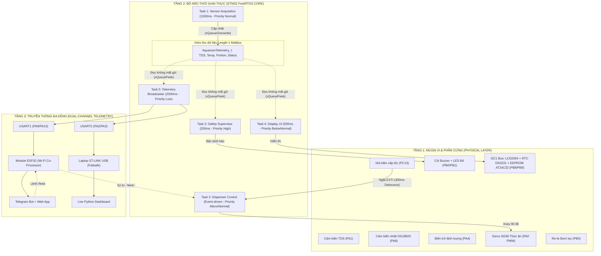

# 🌊 AQUATIC GUARDIAN — BỨC TRANH TOÀN CẢNH (THE BIG PICTURE)
**Hệ Thống Nhúng Thông Minh Giám Sát Bể Cá & Cho Ăn Tự Động Thời Gian Thực**  
*Capstone Project: MCP201 (Microcontroller Programming) — Semester 3 | Lớp: IC2005 | Nhóm: 7*  
*Nền tảng: STM32F4 Nucleo (FreeRTOS / CMSIS-RTOS v2) + ESP32 Wi-Fi Co-Processor*

---

## 📌 1. Mục Tiêu Dự Án (The Core Mission)

Nuôi và bảo tồn sinh vật thủy sinh trong bể cá nhân tạo đòi hỏi 3 điều kiện sống còn:
1. **Chất lượng nước (Water Quality)**: Nồng độ chất rắn hòa tan (**TDS**) và tạp chất hữu cơ phải ở ngưỡng an toàn; nước bẩn hay nồng độ muối/chất thải tăng cao đột ngột sẽ khiến cá ngộ độc.
2. **Nhiệt độ nước (Water Temperature)**: Luôn phải được kiểm soát ổn định trong dải thích nghi (24°C – 28°C).
3. **Chế độ dinh dưỡng (Scheduled Feeding)**: Cho ăn đúng giờ, đúng định lượng. Cho ăn thiếu làm cá đói, cho ăn thừa làm phân hủy thức ăn gây ô nhiễm nguồn nước nghiêm trọng.

**Aquatic Guardian** là giải pháp nhúng hoàn chỉnh thay thế con người chăm sóc bể cá 24/7 bằng kiến trúc **Đa vi điều khiển phân tán (Distributed Dual-MCU Architecture)**:
* **Bộ não thời gian thực STM32 Nucleo** chạy hệ điều hành **FreeRTOS** xử lý cảm biến, thuật toán lọc khử nhiễu, điều phối động cơ, giám sát an toàn và ghi dữ liệu EEPROM.
* **Bộ truyền thông IoT ESP32** kết nối Wi-Fi, cung cấp giao diện điều khiển từ xa qua Telegram Bot và phát Web Dashboard trực tiếp lên điện thoại người dùng.

---

## 🏛️ 2. Kiến Trúc 3 Tầng Toàn Diện (System Architecture)



---

## ⚙️ 3. Cơ Chế Điều Phối FreeRTOS & Xử Lý Đồng Thời

Toàn bộ phần mềm nhúng được hiện thực tại [`src/aquatic_guardian_app.c`](file:///E:/AntiGravityRoot/mcp201-aquatic-guardian/src/aquatic_guardian_app.c) với 5 luồng xử lý chuyên biệt:

| Nhiệm Vụ (Task) | Mức Ưu Tiên | Chu Kỳ | Stack (Bytes) | Vai Trò & Cơ Chế IPC |
| :--- | :--- | :--- | :--- | :--- |
| **`Task_SafetySupervisor`** | `osPriorityHigh` | 200 ms | 1024 | Giám sát an toàn khẩn cấp. Đọc không phá hủy (`xQueuePeek`) từ Mailbox; nếu TDS > 500ppm hoặc Temp > 32°C $\to$ hú còi `PB0` và chớp LED đỏ `PB1`. |
| **`Task_DispenserControl`** | `osPriorityAboveNormal` | Hướng sự kiện | 1024 | Luôn ở trạng thái `Blocked` chờ `feedTriggerSemHandle`. Khi được giải phóng bởi nút bấm, RTC hoặc Telegram $\to$ quay Servo SG90 $90^\circ$, chiếm `i2cBusMutex` ghi lịch sử vào EEPROM (**Minh chứng Priority Inheritance**). |
| **`Task_SensorAcquisition`** | `osPriorityNormal` | 1000 ms | 1024 | Đọc luân phiên ADC TDS (`PA1`), biến trở (`PA4`) và 1-Wire DS18B20 (`PA8`). Đưa qua bộ lọc vòng 20 mẫu và công thức bậc 3 $\to$ ghi đè vào Mailbox (`xQueueOverwrite`). |
| **`Task_DisplayUI`** | `osPriorityBelowNormal` | 500 ms | 2048 | Đọc trộm Mailbox, chiếm `i2cBusMutex` đọc thời gian thực RTC DS3231 và cập nhật thông số lên màn hình LCD 2004. |
| **`Task_Telemetry`** | `osPriorityLow` | 2000 ms | 2048 | Đọc trộm Mailbox, chiếm `uartMutexHandle` đóng gói chuỗi JSON định khung `~` và phát song song qua `USART1` (ESP32) và `USART2` (ST-LINK). |

> [!IMPORTANT]
> **Giải Quyết Lỗi Chết Đói Dữ Liệu (Starvation Flaw)**:  
> Khác với Queue truyền thống (đọc là mất gói dữ liệu, khiến Task ưu tiên cao nuốt hết của Task thấp), hệ thống sử dụng **Hòm thư Length-1 Mailbox** kết hợp hàm `osMessageQueuePeek()`. Nhờ đó, cả 3 tác vụ đọc (Giám sát, LCD, Viễn thông) đều đọc an toàn bản sao mới nhất mà không gây tranh chấp.

---

## 📡 4. Chiến Lược Viễn Thông Kép: ESP32 Điểm Thưởng + Laptop Bảo Hiểm

Để giải quyết bài toán **Lấy trọn điểm cộng tích hợp IoT ESP32** từ giảng viên mà **không bao giờ bị trượt vì mạng Wi-Fi trường bị rớt**, hệ thống phân tách thành 2 cổng vật lý độc lập:

### Kênh 1 (`USART1` — `PA9`/`PA10`): Trình Diễn ESP32 Lấy Điểm Thưởng
* **Phần cứng**: ESP32 cắm trực tiếp trên Breadboard, nối với STM32 qua 3 dây: `PA9` (TX) $\to$ `GPIO16` (RX2), `PA10` (RX) $\to$ `GPIO17` (TX2), chung mass `GND`.
* **Firmware**: Đã nạp sẵn file [`esp32/esp32_aquatic_bridge.ino`](file:///E:/AntiGravityRoot/mcp201-aquatic-guardian/esp32/esp32_aquatic_bridge.ino).
* **Tính năng**:
  * Nhận lệnh từ điện thoại qua Telegram Bot (`/feed`, `/status`).
  * Tự động gửi cảnh báo khẩn cấp (Push Notification) khi nước ô nhiễm.
  * Tích hợp sẵn **Local Web Server**: Điện thoại truy cập vào địa chỉ IP của ESP32 sẽ hiện giao diện Web Dashboard có nút bấm cho cá ăn trực quan.

### Kênh 2 (`USART2` — `PA2`/`PA3`): Bảo Hiểm Failsafe Tuyệt Đối
* **Phần cứng**: Sử dụng chính cáp USB ST-LINK nối từ mạch Nucleo vào Laptop.
* **Kịch bản cứu nguy**: Nếu mạng Wi-Fi tại trường bị chặn tường lửa hoặc sóng yếu không gửi được tin nhắn Telegram, laptop lập tức mở file [`scripts/aquatic_pc_bridge.py`](file:///E:/AntiGravityRoot/mcp201-aquatic-guardian/scripts/aquatic_pc_bridge.py) hiển thị dữ liệu thời gian thực lên máy chiếu. Nhóm bảo vệ trơn tru mà không mất một điểm nào!

---

## 👥 5. Phân Vai & Trách Nhiệm 5 Thành Viên

| Thành Viên | Phân Vai Kỹ Thuật | Nhiệm Vụ Triển Khai (Sẵn Sàng Test Độc Lập) |
| :--- | :--- | :--- |
| **Nghiêm Hoàng Tùng** *(Lead)* | **RTOS Architecture & Concurrency** | Thiết kế 5 Task FreeRTOS, cấu hình stack theo Byte (CMSIS-RTOS v2), tạo Mailbox chống đói dữ liệu, Semaphore cho ăn, Mutex I2C/UART, chống rung nút bấm 300ms trong ngắt EXTI. |
| **Nguyễn Đức Mạnh** | **Sensors & DSP Filtering** | Lắp mạch cảm biến TDS (`PA1`), biến trở (`PA4`), cảm biến nhiệt DS18B20 (`PA8`). Cài đặt bộ lọc vòng 20 phần tử khử nhiễu sóng nước và công thức bù nhiệt bậc 3. *(File test: [`src/standalone_tests/test_tds_filter.c`](file:///E:/AntiGravityRoot/mcp201-aquatic-guardian/src/standalone_tests/test_tds_filter.c))*. |
| **Đỗ Khắc Lê Gia** | **Actuators & Mechanical** | Cấu hình PWM Timer 2 (`PA0`) tạo xung 50Hz cho Servo SG90, chế tạo khay chứa thức ăn Tic-Tac chống kẹt hạt, mạch Rơ-le bơm nước (`PB4`), tính toán sụt áp nguồn 5V. *(File test: [`src/standalone_tests/test_servo_pwm.c`](file:///E:/AntiGravityRoot/mcp201-aquatic-guardian/src/standalone_tests/test_servo_pwm.c))*. |
| **Phạm Hồng Minh** | **I2C Bus & Storage** | Quản lý bus I2C1 (`PB8`/`PB9`), điều khiển màn hình LCD 2004, đọc thời gian thực RTC DS3231, ghi nhật ký ăn vào chip nhớ EEPROM AT24C32 chứng minh cơ chế Priority Inheritance. *(File test: [`src/standalone_tests/test_i2c_scanner.c`](file:///E:/AntiGravityRoot/mcp201-aquatic-guardian/src/standalone_tests/test_i2c_scanner.c))*. |
| **Hoàng Đức Anh** | **IoT, Telemetry & QA** | Nạp firmware ESP32, thiết lập Telegram Bot, quản trị Web Dashboard, kết nối UART định khung `~`, chạy script Python backup và kiểm soát kịch bản bảo vệ. *(File test: [`src/standalone_tests/test_uart_esp32_bridge.c`](file:///E:/AntiGravityRoot/mcp201-aquatic-guardian/src/standalone_tests/test_uart_esp32_bridge.c))*. |

---

## 🎬 6. Kịch Bản 5 Phút Demo Thực Tế Trước Giảng Viên

```
[0:00 - 1:00] Khởi động & Heartbeat
  ├── Cắm nguồn: Rơ-le đóng máy bơm tạch 1 tiếng, LCD2004 sáng đèn.
  ├── LCD hiển thị: TDS đo thực tế, Giờ thực từ DS3231, LED Xanh (PA5) sáng báo an toàn.
  └── Telemetry Task bắn dữ liệu chu kỳ 2s lên màn hình Laptop máy chiếu.

[1:00 - 2:00] Cho ăn tại chỗ & Chứng minh RTOS
  ├── Tùng nhấn nút xanh PC13 trên board Nucleo.
  ├── Ngắt EXTI (đã chống rung 300ms) nhả feedTriggerSemHandle.
  ├── Task_DispenserControl thức tỉnh: Servo SG90 xoay 90° mở nắp nhả hạt thức ăn.
  └── Task chiếm i2cBusMutex ghi giờ ăn vào EEPROM AT24C32 (Chứng minh Priority Inheritance với LCD).

[2:00 - 3:00] Giả lập sự cố nước ô nhiễm
  ├── Mạnh nhúng que đo TDS vào cốc nước muối (TDS tăng vọt > 500ppm).
  ├── Trong vòng 200ms, Task_SafetySupervisor bắt được ngưỡng nguy hiểm:
  │     ├── Còi Buzzer (PB0) hú liên tục, LED Đỏ (PB1) chớp nháy cảnh báo.
  │     └── Rơ-le ngắt bơm hoặc giữ bơm sục khí theo cấu hình an toàn.
  └── ESP32 tự động bắn tin nhắn cảnh báo "CRITICAL ALERT" về Telegram điện thoại!

[3:00 - 4:00] Điều chỉnh định lượng thức ăn
  ├── Gia xoay núm biến trở PA4 (thay đổi định lượng từ 2g đến 12g).
  ├── Màn hình LCD lập tức nhảy số định lượng tương ứng.
  └── Khi cho ăn, thời gian mở nắp Servo giữ lâu hơn tương ứng với số gam hiển thị.

[4:00 - 5:00] Biểu diễn IoT ăn điểm thưởng ESP32
  ├── Đức Anh rút điện thoại ra trước mặt thầy giáo, mở app Telegram gõ "/feed".
  ├── Cần Servo trên bàn quay ngay lập tức!
  ├── Gõ "/status": Bot Telegram gửi về toàn bộ báo cáo TDS, Nhiệt độ và Uptime hệ thống.
  └── Đức Anh mở Web Dashboard trên trình duyệt điện thoại cho thầy xem đồ thị trực quan.
```

---

## 🛡️ 7. Top 5 Câu Hỏi Phòng Thủ "Bất Khả Xâm Phạm"

1. **Thầy hỏi**: *"Tại sao dùng FreeRTOS mà không dùng vòng lặp `while(1)` thông thường?"*  
   * **Trả lời**: Nếu dùng `while(1)`, khi cập nhật màn hình LCD qua I2C (mất 20–50ms) hoặc chờ quay Servo (mất 800ms), toàn bộ hệ thống sẽ bị đóng băng (blocking). Nếu đúng lúc đó nước bị quá nhiệt hoặc cá bị kẹt thì hệ thống không thể xử lý kịp thời. FreeRTOS cho phép **Task Giám Sát An Toàn (200ms) lập tức ngắt (preempt)** các tác vụ in màn hình hay quay servo để bảo vệ bể cá theo thời gian thực!
2. **Thầy hỏi**: *"Priority Inversion (Nghịch đảo mức ưu tiên) là gì và nhóm đã chứng minh giải quyết nó ra sao?"*  
   * **Trả lời**: Bus I2C1 được chia sẻ giữa `Task_DisplayUI` (mức ưu tiên thấp) và `Task_DispenserControl` (mức ưu tiên cao, dùng để ghi log vào EEPROM). Nếu task hiển thị đang giữ Mutex mà có task trung bình chiếm CPU, task cho ăn sẽ bị trễ vô hạn. Nhóm đã kích hoạt cơ chế **Priority Inheritance trên `i2cBusMutex`**, tạm thời nâng quyền ưu tiên của task giữ mutex lên ngang bằng task cho ăn, giải phóng bus ngay lập tức.
3. **Thầy hỏi**: *"Tại sao không đưa lệnh quay Servo trực tiếp vào hàm ngắt nút bấm (EXTI ISR)?"*  
   * **Trả lời**: Quy tắc cốt lõi của lập trình vi điều khiển là **ISR phải chạy nhanh nhất có thể** (vài micro-giây). Quá trình quay Servo cần delay 800ms; nếu đặt delay trong ISR sẽ làm nghẽn toàn bộ hệ thống ngắt của chip. Nhóm dùng cơ chế **Deferred Interrupt Processing**: ISR chỉ nhả `feedTriggerSemHandle` (mất < 1µs) rồi thoát ngay, giao toàn bộ việc quay servo cho `Task_DispenserControl` xử lý.
4. **Thầy hỏi**: *"Tại sao tách ESP32 sang USART1 thay vì cắm chung USART2 với ST-LINK?"*  
   * **Trả lời**: Trên board STM32 Nucleo, `PA2`/`PA3` (USART2) đã được nối cứng bằng cầu hàn phần cứng với chip ST-LINK nạp code. Cắm thêm ESP32 vào đó sẽ gây xung đột phần cứng (bus collision). Nhóm tách sang `USART1` (`PA9`/`PA10`) giúp 2 đường truyền chạy độc lập, đạt hiệu năng cao nhất.
5. **Thầy hỏi**: *"Nếu nước bể cá bị sóng sánh làm số đo ADC nhảy loạn thì làm sao để hệ thống không báo động giả?"*  
   * **Trả lời**: Nhóm áp dụng **Bộ lọc trung bình trượt vòng 20 mẫu (20-sample Circular Moving Average)** với con trỏ vòng $O(1)$. Thuật toán loại bỏ các đỉnh nhiễu đột ngột từ bọt khí và sóng nước, kết hợp với công thức đa thức bậc 3 bù trừ theo nhiệt độ nước thực tế trước khi đưa ra quyết định cảnh báo.

---

## 📁 8. Danh Mục Tài Liệu & Mã Nguồn Trong Workspace

* **Tài liệu thuyết minh đồ án**: [`AQUATIC_GUARDIAN_MASTER_BRIEF.md`](file:///E:/AntiGravityRoot/mcp201-aquatic-guardian/AQUATIC_GUARDIAN_MASTER_BRIEF.md)
* **Danh sách linh kiện & Lưu ý phần cứng (BOM)**: [`docs/hardware_bom_shopping_list.md`](file:///E:/AntiGravityRoot/mcp201-aquatic-guardian/docs/hardware_bom_shopping_list.md)
* **Bảng theo dõi 25 công việc (Excel 8 Tab)**: [`Aquatic_Guardian_Task_Tracker.xlsx`](file:///E:/AntiGravityRoot/mcp201-aquatic-guardian/Aquatic_Guardian_Task_Tracker.xlsx)
* **Mã nguồn FreeRTOS chính**: [`src/aquatic_guardian_app.c`](file:///E:/AntiGravityRoot/mcp201-aquatic-guardian/src/aquatic_guardian_app.c) & [`src/aquatic_guardian_app.h`](file:///E:/AntiGravityRoot/mcp201-aquatic-guardian/src/aquatic_guardian_app.h)
* **Firmware ESP32 Telegram & Web Dashboard**: [`esp32/esp32_aquatic_bridge.ino`](file:///E:/AntiGravityRoot/mcp201-aquatic-guardian/esp32/esp32_aquatic_bridge.ino)
* **Kịch bản Python PC Backup**: [`scripts/aquatic_pc_bridge.py`](file:///E:/AntiGravityRoot/mcp201-aquatic-guardian/scripts/aquatic_pc_bridge.py)
* **Bộ test bench phần cứng độc lập**:
  * Test Servo PWM 50Hz: [`src/standalone_tests/test_servo_pwm.c`](file:///E:/AntiGravityRoot/mcp201-aquatic-guardian/src/standalone_tests/test_servo_pwm.c)
  * Test Lọc ADC & TDS: [`src/standalone_tests/test_tds_filter.c`](file:///E:/AntiGravityRoot/mcp201-aquatic-guardian/src/standalone_tests/test_tds_filter.c)
  * Test Quét địa chỉ I2C: [`src/standalone_tests/test_i2c_scanner.c`](file:///E:/AntiGravityRoot/mcp201-aquatic-guardian/src/standalone_tests/test_i2c_scanner.c)
  * Test Cầu truyền thông ESP32: [`src/standalone_tests/test_uart_esp32_bridge.c`](file:///E:/AntiGravityRoot/mcp201-aquatic-guardian/src/standalone_tests/test_uart_esp32_bridge.c)

