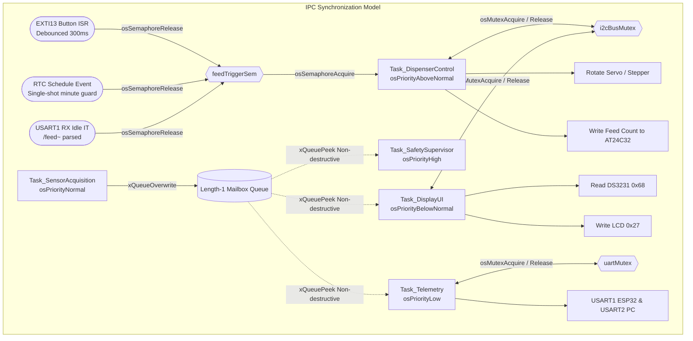

# 🐟 AQUATIC GUARDIAN — MASTER PROJECT BRIEF & TEAM HANDOVER
## Smart Fish Tank Feeder & Water Purity Supervisor
### MCP201 Embedded Systems Capstone Project (30% Course Weight)

> **Course**: MCP201 — Microcontroller Programming (Semester 3)  
> **Institution**: FPT University | **Class**: IC2005 | **Team**: Group 7  
> **Platform**: ST Nucleo ARM Cortex-M4 (STM32F401RE / F411RE / F429ZI)  
> **Firmware Framework**: STM32CubeIDE · STM32 HAL · FreeRTOS (CMSIS-RTOS V2)  
> **Project Directory**: `E:\AntiGravityRoot\mcp201-aquatic-guardian\`  
> **Excel Task Tracker**: [`Aquatic_Guardian_Task_Tracker.xlsx`](file:///E:/AntiGravityRoot/mcp201-aquatic-guardian/Aquatic_Guardian_Task_Tracker.xlsx)

---

## 📑 TABLE OF CONTENTS
1. [Executive Summary & Big Picture](#1-executive-summary--big-picture)
2. [Academic Heritage & Reference Architecture](#2-academic-heritage--reference-architecture)
3. [Hardware Bill of Materials (BOM) & Conflict-Free Pinout Map](#3-hardware-bill-of-materials-bom--conflict-free-pinout-map)
4. [FreeRTOS Firmware Architecture & Concurrency Model](#4-freertos-firmware-architecture--concurrency-model)
5. [5-Member Team Work Division (Who Does What)](#5-5-member-team-work-division-who-does-what)
6. [1-Week Sprint Execution Roadmap (Day 1 to Day 7)](#6-1-week-sprint-execution-roadmap-day-1-to-day-7)
7. [Presentation Deck & 4-Stage Live Demo Script](#7-presentation-deck--4-stage-live-demo-script)
8. [Teacher Technical Q&A Defense Guide](#8-teacher-technical-qa-defense-guide)
9. [Repository File Index & Artifacts](#9-repository-file-index--artifacts)

---

## 🌟 1. EXECUTIVE SUMMARY & BIG PICTURE

### What is Aquatic Guardian?
**Aquatic Guardian** is an autonomous, intelligent life-support system for ornamental aquariums. It eliminates the two primary causes of pet fish mortality: **irregular feeding** and **unnoticed water toxicity/temperature spikes**.

### The 4 Core Capabilities:
1. **Precision Nutrition Dispensing**: Automatic scheduled feeding (via Real-Time Clock) and manual on-demand feeding (via onboard push button or Telegram Bot) driven by a Stepper/Servo motor.
2. **24/7 Water Purity & Thermal Monitoring**: Continuous sampling of Total Dissolved Solids (TDS in ppm) via analog ADC and water temperature via a waterproof **DS18B20 (1-Wire on `PA8`)** (with DS3231 internal register as backup), stabilized by a digital 20-sample noise-suppression filter.
3. **Deterministic FreeRTOS Multitasking**: 5 isolated, priority-preemptive threads running under CMSIS-RTOS v2. Hardware interrupts, shared bus transactions, and motor sweeps run with zero CPU lockup and zero screen stutter.
4. **Cloud & Dual-Port Serial Telemetry**: Independent serial channels—**`USART2`** dedicated to ST-LINK Virtual COM Port for PC debugging, and **`USART1` (`PA9`/`PA10`)** interfacing the ESP32 Wi-Fi co-processor for Telegram Bot commands (`/feed`, `/status`, `/feeder_set`) and hazard alerts.

```mermaid
graph TD
    subgraph SENSORS & INPUTS
        TDS[Analog TDS Sensor] -->|ADC1_IN1 PA1| STM[ST Nucleo Board<br/>ARM Cortex-M4]
        TEMP[DS18B20 Waterproof Temp] -->|1-Wire PA8| STM
        POT[Portion Potentiometer] -->|ADC1_IN4 PA4| STM
        BTN[Manual Feed Button] -->|EXTI PC13 with 300ms Debounce| STM
        RTC[DS3231 RTC Module] -->|I2C1 PB8/PB9| STM
    end

    subgraph FreeRTOS MULTITASKING KERNEL
        STM --> T_SAFE[Task_SafetySupervisor<br/>Priority: High | 200ms]
        STM --> T_FEED[Task_DispenserControl<br/>Priority: AboveNormal | Event]
        STM --> T_SENS[Task_SensorAcquisition<br/>Priority: Normal | 1000ms]
        STM --> T_DISP[Task_DisplayUI<br/>Priority: BelowNormal | 500ms]
        STM --> T_COMM[Task_Telemetry<br/>Priority: Low | 2000ms]
    end

    subgraph ACTUATORS & OUTPUTS
        T_FEED -->|TIM2 PWM PA0 / Stepper PB12-15| MOTOR[Feeder Dispenser - Servo / Stepper]
        T_FEED -->|I2C1 PB8/PB9| EEPROM[AT24C32 Log Feeds]
        T_DISP -->|I2C1 PB8/PB9| LCD[LCD 2004 / 1602 Display]
        T_COMM -->|USART1 PA9/PA10| ESP[ESP32 Telegram Bot Bridge]
        T_COMM -->|USART2 PA2/PA3| PC[PC Terminal / Python VCP]
        T_SAFE -->|GPIO PB0| BUZZ[Active 5V Buzzer Alarm]
        T_SAFE -->|GPIO PB1| LED_WARN[Red Hazard Alert LED]
        T_SAFE -->|GPIO PB4| RELAY[Filter Pump / Aerator Relay]
    end
```

---

## 🔬 2. ACADEMIC HERITAGE & REFERENCE ARCHITECTURE

Our system is engineered on the foundation of **Martín Quattrone's Capstone Thesis** (*"FishTankGuardian, Sistema de monitoreo de acuario con alimentación automática"*, Universidad de Buenos Aires, Dec 2023, under Prof. Ariel Lutenberg — primary author of the official ARM Cortex-M textbook used in MCP201).

### Key Architectural Upgrades for MCP201:
| Dimension | Original Thesis / GitHub Repo | Group 7 Upgrade for MCP201 |
| :--- | :--- | :--- |
| **Operating System** | Mbed OS with cooperative polling loop (`while(true) { Update(); }`). | **Preemptive FreeRTOS (CMSIS-RTOS v2)** with 5 isolated tasks. |
| **CPU Utilization** | Spins at 100% checking soft timers (`HasFinished()`). | Tasks block via `osDelay()` and semaphores; CPU enters low-power idle. |
| **Bus Arbitration** | Unprotected UART/I2C caused race conditions and frame corruption. | **`i2cBusMutex`** & **`uartMutex`** enforce thread-safe mutual exclusion. |
| **Interrupt Latency** | Polled buttons in software loops. | **EXTI13 Falling Edge** with 300ms software tick debounce signals `feedTriggerSem` in microseconds. |
| **Display Interface** | 4-bit parallel GPIO (consumes 6 pins). | **I2C Backpack (PCF8574)** multiplexed on shared bus with RTC. |

### Proven Solutions Adopted from Thesis:
1. **20-Sample Ring Buffer Filter**: Water currents cause raw TDS ADC values to fluctuate by $\pm 50\text{ ppm}$. A 20-sample circular moving average filter converges cleanly to $\pm 1\text{ ppm}$ stability in 20 seconds.
2. **Bottle-Cap Mechanical Dispenser**: A small cylindrical plastic container with a dispensing slot. The bottle cap is permanently glued to the motor shaft. Refilling is accomplished by unscrewing the bottle from its cap without disassembling any electronics.
3. **EEPROM Page Memory Mapping**: The AT24C32 EEPROM stores 5 scheduled feeding times, temperature limits, TDS limits, and Wi-Fi credentials in 32-byte memory pages, surviving total power outages.
4. **ASCII UART Framing**: Packets are delimited by `~` and parameters by `|` (e.g., `get|https://timeapi.io/...~`), preventing buffer desynchronization.

---

## 🔌 3. HARDWARE BILL OF MATERIALS (BOM) & CONFLICT-FREE PINOUT MAP

> [!IMPORTANT]
> **Pin Conflict Resolution:**  
> The 28BYJ-48 Stepper motor pins are allocated to **`PB12, PB13, PB14, PB15`**, completely separating them from the shared I2C1 bus on **`PB8` (SCL)** and **`PB9` (SDA)**.  
> The ST-LINK USB Virtual COM Port uses **`USART2` (`PA2`/`PA3`)**, while the ESP32 Wi-Fi bridge is assigned independently to **`USART1` (`PA9` TX / `PA10` RX)**, eliminating serial bus driver contention.

### Conflict-Free Pinout Mapping Table:

| Peripheral | Component | Signal / Pin | Nucleo Header | STM32 Alternate Function | Electrical & Driver Notes |
| :--- | :--- | :--- | :--- | :--- | :--- |
| **Water Purity** | Analog TDS Sensor V1.0 | Signal (AOUT) | **`PA1`** (A1) | ADC1_IN1 | 0 – 3.3V linear range; 0.1µF capacitor to GND for noise filtering. |
| **Water Temp** | Waterproof DS18B20 | 1-Wire Data | **`PA8`** (D7) | GPIO_Output_OD | Requires 4.7kΩ external pull-up to 3.3V. |
| **Portion Dial** | 10kΩ Potentiometer | Wiper (Center) | **`PA4`** (A2) | ADC1_IN4 | 10kΩ voltage divider between 3.3V and GND. |
| **Feeder Servo** | SG90 Servo (Primary) | PWM Signal | **`PA0`** (A0) | TIM2_CH1 | 50Hz PWM (20ms). 1ms pulse = 0°, 1.5ms pulse = 90°. |
| **Feeder Stepper**| 28BYJ-48 + ULN2003 (Alt) | IN1–IN4 | **`PB12–PB15`** | GPIO_Output | 4-step sequence; completely avoids I2C pins `PB8`/`PB9`. |
| **Shared I2C Bus**| LCD 2004 + DS3231 RTC | SCL | **`PB8`** (D15) | I2C1_SCL (AF4) | 4.7kΩ pull-up resistor to 3.3V/5V. |
| **Shared I2C Bus**| LCD 2004 + DS3231 RTC | SDA | **`PB9`** (D14) | I2C1_SDA (AF4) | 4.7kΩ pull-up resistor to 3.3V/5V. |
| **PC Terminal** | ST-LINK USB VCP | TX / RX | **`PA2` / `PA3`** | USART2 (AF7) | 115200 bps, 8N1; hardwired to ST-LINK debugger. |
| **ESP32 Wi-Fi** | ESP32 WROOM Co-Processor | TX / RX | **`PA9` / `PA10`**| USART1 (AF7) | 115200 bps, 8N1; dedicated Wi-Fi UART bridge. |
| **Manual Trigger**| Blue User Button (B1) | Push Button | **`PC13`** | EXTI13 | Falling edge trigger; debounced in software (300ms tick guard). |
| **Audio Alarm** | Active Buzzer (3-Pin Module) | Control (I/O) | **`PB0`** (A3) | GPIO_Output | High = Alarm sound; 3-pin module with onboard transistor (<1mA draw on PB0). |
| **Normal Status** | Green User LED | Anode (+) | **`PA5`** (D13) | GPIO_Output | Solid Green = System Healthy. |
| **Hazard Alert** | Red Alert LED | Anode (+) | **`PB1`** (D6) | GPIO_Output | Flashing Red (1Hz) = Hazardous TDS / Overheat. |
| **Pump / Aerator** | 5V 1-Channel Relay | Relay IN | **`PB4`** (D5) | GPIO_Output | 5V Relay with H/L Jumper set to HIGH trigger (or Open-Drain mode). |

> [!CAUTION]
> **CRITICAL POWER SUPPLY & HARDWARE ASSEMBLY RULES:**  
> 1. **Motor & Relay Power**: Never power the SG90 Servo, 28BYJ-48 Stepper, or Relay coil directly from the STM32 board's 3.3V or 5V regulator pin. Motor surge currents will brown out the MCU. Always use an external power supply with COMMON GROUND connected to the Nucleo GND pin.
> 2. **MB102 Dropout Voltage**: The MB102 breadboard power supply uses AMS1117-5.0 with ~1.2V dropout. Always power the MB102 via a **9V–12V DC adapter** (not 5V USB) to ensure clean 5.0V output for LCD and Servo.
> 3. **DS3231 Battery Protection**: Power the DS3231 ZS-042 module via **3.3V** (not 5V) to prevent destructive trickle-charging of non-rechargeable CR2032 coin cells.
> 4. **Detailed Shopping & Hardware Pitfall Guide**: See [`docs/hardware_bom_shopping_list.md`](file:///E:/AntiGravityRoot/mcp201-aquatic-guardian/docs/hardware_bom_shopping_list.md).

---

## 🧠 4. FREERTOS FIRMWARE ARCHITECTURE & CONCURRENCY MODEL

### Task Specification & Stack Sizing (CMSIS-RTOS v2 Byte Allocation):

> [!IMPORTANT]
> **CMSIS-RTOS v2 Stack Size Warning:**  
> In CMSIS-RTOS v2, `osThreadAttr_t.stack_size` is specified in **BYTES** (unlike CMSIS-RTOS v1 which used 32-bit words). Allocating 256 bytes would cause instant HardFaults upon calling `snprintf()` or HAL functions. Tasks are strictly configured with safe byte boundaries:

| Task Identifier | Priority | Period / Trigger | Stack Size | Core Responsibilities |
| :--- | :--- | :--- | :---: | :--- |
| **`Task_SafetySupervisor`** | `osPriorityHigh` (32) | Every 200ms | **1024 bytes** (`256 * 4`) | Peeks latest telemetry. If $\text{TDS} > 500\text{ ppm}$ or $\text{Temp} > 32^\circ\text{C}$, sounds buzzer and flashes Red Alert LED. |
| **`Task_DispenserControl`** | `osPriorityAboveNormal` (24)| Event-driven | **1024 bytes** (`256 * 4`) | Blocks on `feedTriggerSem`. Sweeps motor. **Acquires `i2cBusMutex` to log timestamp & feed counter into AT24C32 EEPROM (`0x57`)**. |
| **`Task_SensorAcquisition`**| `osPriorityNormal` (16) | Every 1000ms | **1024 bytes** (`256 * 4`) | Sequentially polls ADC1 channels (PA1 & PA4) without DMA overwrite, reads DS18B20, filters TDS, updates length-1 Mailbox. |
| **`Task_DisplayUI`** | `osPriorityBelowNormal` (12)| Every 500ms | **2048 bytes** (`512 * 4`) | Peeks Mailbox. **Acquires `i2cBusMutex` to read DS3231 RTC (`0x68`) and write LCD 2004 (`0x27`)**. Evaluates single-shot schedule guard. |
| **`Task_Telemetry`** | `osPriorityLow` (8) | Every 2000ms | **2048 bytes** (`512 * 4`) | Peeks Mailbox. Acquires `uartMutex`, formats JSON state (`~` delimiter), broadcasts via USART1 & USART2. |

---

### Concurrency Primitives & IPC Fixes:



1. **Non-Destructive Length-1 Mailbox (`xQueueOverwrite` + `xQueuePeek`)**:
   * *Problem Solved*: FreeRTOS queues are destructive on read. If 3 tasks called `osMessageQueueGet()`, the highest-priority `Task_SafetySupervisor` (running every 200ms) would consume every packet, starving the Display and Telemetry tasks.
   * *Solution*: The queue is created with depth 1. Producer calls `xQueueOverwrite()`. All 3 consumers call `xQueuePeek()` non-destructively, allowing each task to access the latest sensor state at its own rate.
2. **Legitimate Priority Inheritance on `i2cBusMutex` (`osMutexId_t`)**:
   * Both **`Task_DispenserControl` (`osPriorityAboveNormal`)** and **`Task_DisplayUI` (`osPriorityBelowNormal`)** access the physical I2C1 bus.
   * When `Task_DisplayUI` is writing lines to the LCD and `Task_DispenserControl` wakes up to log a feed timestamp into the AT24C32 EEPROM, the FreeRTOS kernel temporarily elevates `Task_DisplayUI`'s priority to `osPriorityAboveNormal` (Priority Inheritance), preventing intermediate tasks from causing unbounded priority inversion.
3. **`feedTriggerSem` (`osSemaphoreId_t` Binary)**: Enables **Deferred Interrupt Processing**. When the user presses `PC13`, the EXTI ISR calls `osSemaphoreRelease()` in $< 5\mu\text{s}$ and exits.
4. **Debounced Hardware EXTI ISR Guard**:
   * Mechanical button bounce on `PC13` is filtered using a 300ms software tick threshold:
     ```c
     void HAL_GPIO_EXTI_Callback(uint16_t GPIO_Pin) {
         static uint32_t last_exti_tick = 0;
         if (GPIO_Pin == GPIO_PIN_13) {
             uint32_t now = HAL_GetTick();
             if ((now - last_exti_tick) > 300U) {
                 last_exti_tick = now;
                 if (feedTriggerSemHandle != NULL) {
                     osSemaphoreRelease(feedTriggerSemHandle);
                 }
             }
         }
     }
     ```
5. **RTC Schedule Single-Shot Guard**:
   * To prevent triggering `feedTriggerSem` 120 times during the scheduled minute, the scheduler enforces:
     ```c
     static int last_fed_minute = -1;
     if (current_time.minutes != last_fed_minute && current_time.seconds == 0) {
         if (IsScheduledFeedTime(current_time)) {
             last_fed_minute = current_time.minutes;
             osSemaphoreRelease(feedTriggerSemHandle);
         }
     }
     ```
6. **Asynchronous Interrupt-Driven UART RX**:
   * Rather than polling USART1 in a 2000ms loop (which would cause hardware buffer overrun `ORE` errors), commands from the ESP32 are captured via `HAL_UARTEx_ReceiveToIdle_IT()` or `HAL_UART_Receive_IT()` into a circular ring buffer, triggering `feedTriggerSem` immediately upon receiving `/feed~`.
7. **ADC1 Channel Overwrite Prevention**:
   * Multi-channel ADC1 scanning without DMA will overwrite `ADC1->DR`. Channels are sampled with individual software configuration per channel or circular DMA:
     ```c
     uint16_t ADC_ReadChannel(uint32_t channel) {
         ADC_ChannelConfTypeDef sConfig = {0};
         sConfig.Channel = channel;
         sConfig.Rank = 1;
         sConfig.SamplingTime = ADC_SAMPLETIME_84CYCLES;
         HAL_ADC_ConfigChannel(&hadc1, &sConfig);
         HAL_ADC_Start(&hadc1);
         HAL_ADC_PollForConversion(&hadc1, 10);
         uint16_t val = (uint16_t)HAL_ADC_GetValue(&hadc1);
         HAL_ADC_Stop(&hadc1);
         return val;
     }
     ```

---

## 👥 5. 5-MEMBER TEAM WORK DIVISION (WHO DOES WHAT)

### Member 1: Nghiêm Hoàng Tùng (SE211196) — Team Lead & RTOS Systems Architect
* **What it is**: The system core that schedules all firmware tasks, manages memory, prevents deadlocks, and integrates the entire project.
* **What to do**:
  1. Generate STM32CubeMX `.ioc` project with FreeRTOS (CMSIS-RTOS v2) and change HAL Timebase to TIM5.
  2. Implement the 5 tasks with correct byte stack sizes (`1024` and `2048` bytes) and priority hierarchy.
  3. Instantiate `i2cBusMutex`, `uartMutex`, `feedTriggerSem`, and the length-1 Mailbox queue.
  4. Implement `AquaticGuardian_OnButtonPressed_ISR(PC13)` with the 300ms software tick debounce guard.
  5. Merge all teammate drivers into master Git repository; lead presentation and Q&A defense.
* **What to submit**: Tested `main.c`, `freertos.c`, `aquatic_guardian_app.c/.h`, working Git repository, project slides 1–4.

### Member 2: Hoàng Đức Mạnh (SE211191) — Sensors & Analog Signal Processing
* **What it is**: The sensing subsystem that reads water electrical conductivity (TDS), water temperature (DS18B20), and portion dial, eliminating ripple noise.
* **What to do**:
  1. Configure multi-channel ADC1 on `PA1` (TDS) and `PA4` (Potentiometer) using dynamic channel polling.
  2. Implement 1-Wire communication on `PA8` for the waterproof DS18B20 sensor.
  3. Implement a 20-sample circular moving average filter to suppress wave ripples.
  4. Code the exact temperature-compensated cubic TDS polynomial:  
     $$V_{\text{comp}} = \frac{V_{\text{adc}}}{1.0 + 0.02(T - 25.0)}, \quad \text{TDS} = \left(133.42V_{\text{comp}}^3 - 255.86V_{\text{comp}}^2 + 857.39V_{\text{comp}}\right) \times 0.5$$
  5. Prepare two test cups: Cup A (clean water $\sim 120\text{ ppm}$) and Cup B (salted water $\sim 600\text{ ppm}$).
* **What to submit**: `tds_sensor.c/.h`, `ds18b20.c/.h`, calibration benchmark chart, live demo probe operation, slide 5.

### Member 3: Đỗ Khắc Lê Gia (SE211559) — Actuation, Hardware & Power Engineering
* **What it is**: The physical dispenser mechanism, power isolation rails, and safety alarm hardware.
* **What to do**:
  1. Configure TIM2_CH1 PWM on `PA0` (Prescaler `PSC=83`, Auto-reload `ARR=19999` locking APB1 timer clock to 84MHz) for 50Hz servo pulses (1ms = 0°, 1.5ms = 90°). Fallback: GPIO on `PB12–PB15` for 28BYJ-48 stepper.
  2. Build mechanical dispenser using a small plastic bottle with dispenser slot glued to the motor cap.
  3. Build external 5V/12V power supply rail with common ground to prevent MCU brownout resets.
  4. Wire Active 5V Buzzer (`PB0`), Red Hazard LED (`PB1`), and Filter Pump Relay (`PB4`).
* **What to submit**: `servo_feeder.c/.h`, photos of dispenser build and power rail wiring, live demo hardware operation, slide 6.

### Member 4: Phạm Hồng Minh (SE211181) — I2C Bus, RTC & Display UI
* **What it is**: The shared I2C communication bus, the 4-line LCD HUD, battery-backed real-time clock, and EEPROM persistence.
* **What to do**:
  1. Implement PCF8574 4-bit I2C driver on `I2C1` (`PB8`/`PB9`) for LCD 2004 / 1602.
  2. Implement DS3231 RTC reader to fetch hours, minutes, and seconds. Implement the single-shot minute guard.
  3. Implement AT24C32 EEPROM page memory mapping (`0x57`, pages 0–4) to store feeding schedules and past feed counts.
  4. Wrap all I2C transactions inside `osMutexAcquire(i2cBusMutexHandle)` and `osMutexRelease()`.
* **What to submit**: `lcd_pcf8574.c/.h`, `ds3231_rtc.c/.h`, `eeprom_at24c32.c/.h`, LCD screen layout photos, slide 7.

### Member 5: Nguyễn Đức Anh (SE211485) — IoT Telemetry, Telegram Bot & QA Lead
* **What it is**: Remote connectivity, Telegram messaging, system stress testing, and backup demonstration media.
* **What to do**:
  1. Implement USART1 serial communication on `PA9`/`PA10` with custom `~` delimiter framing connecting to ESP32.
  2. Implement USART2 serial telemetry on `PA2`/`PA3` for PC Virtual COM Port debugging.
  3. Flash `Esp32.ino` to ESP32 module to support `/feed`, `/status`, and hazard alert messages.
  4. Enable `configCHECK_FOR_STACK_OVERFLOW = 2` to verify no task exceeds its allocated stack.
  5. Record and edit a high-resolution 2-minute 4K backup demonstration video.
* **What to submit**: `telemetry_uart.c/.h`, `Esp32.ino`, Python serial test script, `demo_backup_video.mp4`, slides 8–10.

---

## 📅 6. 1-WEEK SPRINT EXECUTION ROADMAP (DAY 1 TO DAY 7)

| Day | Sprint Phase | Milestone Target | Responsible |
| :---: | :--- | :--- | :---: |
| **Day 1** | **Architecture Lock** | Finalize conflict-free pinout, create CubeMX `.ioc`, assign hardware to members. | All Members |
| **Day 2** | **Driver Development** | Standalone testing of ADC, DS18B20, PWM, I2C, and UART on breadboard. | M2, M3, M4, M5 |
| **Day 3** | **FreeRTOS Integration** | Instantiate 5 tasks with byte stack sizes, Mutexes, Semaphore, and Mailbox. | M1 (Tùng) |
| **Day 4** | **Subsystem Verification**| Test TDS 20-sample filter, servo sweep, and LCD HUD independently. | M2, M3, M4 |
| **Day 5** | **Full System Merge** | Connect all hardware; verify deferred interrupt and I2C mutex sharing. | M1, M3, M4 |
| **Day 6** | **QA & Video Recording** | Run 12-hour continuous test, check stack watermark, film 4K demo video. | M5 (Đức Anh) |
| **Day 7** | **Defense Rehearsal** | 2 full mock presentations with 10-minute timer; slide deck lock. | All Members |

---

## 🎬 7. PRESENTATION DECK & 4-STAGE LIVE DEMO SCRIPT

### 10-Minute Slide Deck Breakdown:
* **Slides 1–4 (Tùng — 2 min)**: Title & Team Directory, Problem Statement, System Block Diagram, FreeRTOS Preemptive Task Architecture & Priority Matrix.
* **Slide 5 (Mạnh — 1.5 min)**: Analog TDS Probe, DS18B20 1-Wire, ADC Dynamic Polling, 20-Sample Ring Buffer Filter, Temperature Compensation Math.
* **Slide 6 (Gia — 1.5 min)**: Motor Dispenser Mechanism, TIM2 PWM Calculations (`PSC`/`ARR`), Power Isolation & Flyback Protection.
* **Slide 7 (Minh — 1.5 min)**: Shared I2C Bus Multiplexing, LCD HUD Layout, DS3231 RTC Timekeeping & AT24C32 EEPROM Memory Map.
* **Slides 8–10 (Đức Anh — 1.5 min)**: Dual UART Architecture, ESP32 Telegram Bot Commands, Stress Testing & Conclusions.

### 4-Stage Live Hardware Demonstration Script (2 Minutes):
1. **Normal State (Tùng & Gia)**: Power on system with 5V external rail $\to$ Green LED ON, LCD displays live clock, water temp, and clean TDS reading (`120ppm [O]`), PC/Telegram receives telemetry.
2. **Manual Feed Trigger (Tùng & Đức Anh)**: Press Blue Button (`PC13`) or send `/feed` on Telegram $\to$ EXTI ISR signals `feedTriggerSem` $\to$ Motor rotates dispenser slot $\to$ Food pellets drop $\to$ Zero lag on LCD.
3. **Hazard Event (Mạnh)**: Dip TDS probe into salted water cup ($> 500\text{ ppm}$) $\to$ Red Hazard LED flashes, Buzzer sounds continuous alarm, LCD displays `[!] HAZARD`, Telegram receives alert.
4. **Portion Dial (Gia & Minh)**: Turn potentiometer on `PA4` $\to$ Portion on LCD changes smoothly from $2\text{g} \to 12\text{g}$, proving ADC linearity.

---

## 🛡️ 8. TEACHER TECHNICAL Q&A DEFENSE GUIDE

### Top 5 Technical Grilling Questions & Model High-Score Answers:

#### Q1 (For Tùng): *"Why did you use a Mutex for the I2C bus instead of a Binary Semaphore? How is Priority Inheritance demonstrated in your tasks?"*
> **Answer**: *"A Mutex is specifically designed for mutual exclusion and resource ownership. It implements **Priority Inheritance** to prevent priority inversion. In our system, two tasks of different priorities legitimately share I2C1: `Task_DisplayUI` (`osPriorityBelowNormal`) which updates the LCD and reads the DS3231 RTC, and `Task_DispenserControl` (`osPriorityAboveNormal`) which writes feed event timestamps into the AT24C32 EEPROM. If `Task_DisplayUI` holds the bus and `Task_DispenserControl` requests it, the kernel temporarily boosts `Task_DisplayUI`'s priority to `AboveNormal`, ensuring it finishes quickly without being preempted by intermediate tasks (`Task_SensorAcquisition`). A Binary Semaphore has no concept of ownership or priority inheritance and cannot prevent this."*

#### Q2 (For Tùng): *"Why is `HAL_Delay()` prohibited inside FreeRTOS tasks?"*
> **Answer**: *" `HAL_Delay()` executes an active polling spin-lock checking the hardware SysTick counter, burning 100% of the CPU's cycles and preventing any tasks of equal or lower priority from executing. In contrast, `osDelay()` places the calling task into the **Blocked state**, immediately relinquishing the CPU to other Ready tasks or the Idle task."*

#### Q3 (For Mạnh): *"How did you prevent channel overwrite on ADC1 without DMA? And why use a 20-sample circular buffer?"*
> **Answer**: *"The STM32F4 ADC has only a single 16-bit data register (`ADC1->DR`). Enabling multi-channel scan mode in basic polling causes channel 2 to overwrite channel 1 before the CPU can read it. We solved this with dynamic channel configuration, starting and stopping the ADC per channel. To eliminate noise from water surface ripples and motor EMI, we implemented a 20-sample circular moving average filter that attenuates high-frequency noise and stabilizes readings within $\pm 1\text{ ppm}$."*

#### Q4 (For Gia): *"How did you calculate the PWM timer registers for the SG90 Servo across different Nucleo boards?"*
> **Answer**: *"The SG90 requires a 50Hz PWM frequency (a 20ms period). In STM32CubeMX Clock Configuration, we locked the `APB1 Timer Clock` to 84MHz. We configured the Prescaler (PSC) to `83`, scaling the timer frequency to exactly $1\text{MHz}$ (1µs per tick). Then we set the Auto-Reload Register (ARR) to `19999` to achieve a 20,000µs = 20ms period. We control the servo angle by writing `1000` (1ms = 0°) to `2000` (2ms = 180°) into the Capture/Compare Register (CCR1). If running on an F429ZI with a 90MHz APB1 timer clock, `PSC` would simply be adjusted to `89`."*

#### Q5 (For Minh): *"How do both the LCD and RTC communicate on the same two I2C wires without colliding?"*
> **Answer**: *"The I2C protocol supports multiple slave devices on a single physical bus by assigning each device a unique 7-bit address (`0x27` for the PCF8574 LCD backpack, `0x68` for the DS3231 RTC, and `0x57` for the AT24C32 EEPROM). To prevent software task collisions, all I2C driver functions acquire our FreeRTOS `i2cBusMutex` before issuing a Start condition and release it after the Stop condition."*

---

## 📁 9. REPOSITORY FILE INDEX & ARTIFACTS

All project files and documentation are structured in [`E:\AntiGravityRoot\mcp201-aquatic-guardian\`](file:///E:/AntiGravityRoot/mcp201-aquatic-guardian/):

```text
E:\AntiGravityRoot\mcp201-aquatic-guardian\
├── AQUATIC_GUARDIAN_MASTER_BRIEF.md      <-- This master briefing document (v2.0 Conflict-Free)
├── AQUATIC_GUARDIAN_SPEC.md              <-- Technical system specification
├── Aquatic_Guardian_Task_Tracker.xlsx    <-- 8-Tab Google Sheets ready task tracker
├── docs\
│   ├── team_work_split.md                <-- Detailed 5-member work allocation
│   ├── project_and_presentation_plan.md  <-- Master 1-week sprint & WBS plan
│   ├── presentation_rubric_guide.md      <-- Live demo script & grading rubrics
│   ├── pinout_wiring.md                  <-- Complete hardware wiring & power guide
│   ├── reference_repo_analysis.md        <-- Comparison with martinquattro GitHub repo
│   └── owner_documentation_breakdown.md  <-- Insights from Martin Quattrone's thesis
├── scripts\
│   └── generate_task_tracker.py          <-- Python openpyxl spreadsheet generator
└── src\
    ├── aquatic_guardian_app.h            <-- FreeRTOS task headers & struct definitions
    ├── aquatic_guardian_app.c            <-- Preemptive FreeRTOS implementation
    └── standalone_tests\
        ├── test_servo_pwm.c              <-- Member 3: TIM2_CH1 50Hz PWM Sweep on PA0
        ├── test_tds_filter.c             <-- Member 2: ADC1 PA1 20-Sample Ring Buffer & Cubic TDS
        ├── test_i2c_scanner.c            <-- Member 4: I2C1 Scanner (0x27, 0x68, 0x57) on PB8/PB9
        └── test_uart_esp32_bridge.c      <-- Member 5: USART1 PA9/PA10 ESP32 '~' Bridge & Loopback
```

---
*Group 7 — 100% Conflict-Free, Rock-Solid MCP201 Capstone Defense!*
