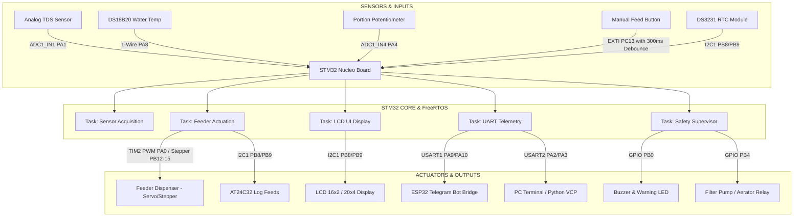

# 🐟 Aquatic Guardian — Smart Fish Tank Monitor & Automated Feeder
## Embedded Systems Capstone Project (MCP201)

> **Course**: MCP201 — Microcontroller Programming (Semester 3)  
> **Platform**: STM32 ARM Cortex-M4 (ST Nucleo-F401RE / F411RE / F429ZI)  
> **Framework**: STM32CubeIDE · STM32 HAL · FreeRTOS (CMSIS-RTOS V2)  
> **Topic**: #8 — Fish Tank Guardian / Aquatic Guardian (Automated Dispenser & Water Health Monitor)

---

## 📌 Executive Summary

**Aquatic Guardian** is an intelligent, real-time embedded aquarium management system engineered to preserve aquatic life through automated nutrition dispensing, continuous water purity analysis, and environmental safety supervision.

Running on an **ARM Cortex-M4 (STM32)** microcontroller under **FreeRTOS**, the system guarantees deterministic task execution:
1. **Precision Nutrition Dispensing**: Scheduled and on-demand feeding driven by hardware PWM / Stepper actuation.
2. **Water Purity & Thermal Monitoring**: Real-time Total Dissolved Solids (TDS in ppm) via analog ADC and water temperature via a waterproof **DS18B20 (1-Wire on `PA8`)**.
3. **Safe Real-Time Multitasking**: Deterministic scheduling using CMSIS-RTOS V2 with Mutex-protected shared buses, deferred interrupt handling (EXTI $\to$ Binary Semaphore), and a non-destructive Length-1 Mailbox queue.
4. **Cloud / Dual-Port Serial Telemetry**: Independent serial channels—**`USART2`** for PC ST-LINK debugging and **`USART1` (`PA9`/`PA10`)** for ESP32 Wi-Fi Telegram Bot commands.



---

## 🛠️ 1. Hardware Bill of Materials (BOM) & Pinout

| Subsystem | Component | Interface | STM32 Nucleo Pinout | Role |
| :--- | :--- | :--- | :--- | :--- |
| **MCU Board** | ST Nucleo-F401RE / F411RE / F429ZI | — | — | Main 84MHz / 100MHz / 180MHz Cortex-M4 Controller |
| **Water Quality** | Analog TDS Meter V1.0 | ADC1_IN1 | **`PA1`** (Analog) | Measure water purity (0–1000 ppm) |
| **Water Temp** | Waterproof DS18B20 | 1-Wire | **`PA8`** (Digital OD)| Accurate water temperature (4.7kΩ pull-up to 3.3V) |
| **Portion Dial** | 10kΩ Linear Potentiometer | ADC1_IN4 | **`PA4`** (Analog) | User adjustable feed dosage (1 – 15g) |
| **Feeder Servo** | SG90 / MG90S Servo Motor | TIM2_CH1 | **`PA0`** (PWM 50Hz) | Precise hopper rotation for dispensing |
| **Feeder Stepper**| 28BYJ-48 + ULN2003 (Alt) | GPIO Out | **`PB12–PB15`** | 4-step sequence (avoids I2C pins PB8/PB9 completely) |
| **Real-Time Clock**| DS3231 Precision RTC | I2C1 | **`PB8`** (SCL), **`PB9`** (SDA) | Accurate timekeeping & feeding schedule |
| **Visual UI** | LCD 1602 / 2004 with I2C | I2C1 | **`PB8`** (SCL), **`PB9`** (SDA) | Displays water ppm, time, feeding countdown |
| **Remote Bridge** | ESP32 Wi-Fi Co-Processor | USART1 | **`PA9`** (TX), **`PA10`** (RX)| Telegram Bot bridge (`115200 bps`, `~` framing) |
| **PC Terminal** | ST-LINK USB VCP | USART2 | **`PA2`** (TX), **`PA3`** (RX) | Live serial telemetry to PC debug console |
| **Manual Trigger** | Push Button (Debounced) | EXTI13 | **`PC13`** (User Button) | Triggers instant manual feed cycle (300ms tick guard) |
| **Alarm Module** | Active 5V Buzzer | GPIO Output | **`PB0`** (Push-Pull) | Sounds alarm if water is contaminated or overheated |
| **Status Alert** | Normal Green LED / Hazard Red LED| GPIO Output | **`PA5`** (Green), **`PB1`** (Red) | Green: Normal, Red: Hazard Alert |
| **Appliance Relay**| 5V 1-Channel Relay Module | GPIO Output | **`PB4`** (Push-Pull) | Controls aquarium pump / aeration |

---

## 🧠 2. FreeRTOS Multitasking Architecture

```mermaid
flowchart TD
    ISR_BTN([EXTI13 Button ISR<br/>Debounced 300ms]) -->|osSemaphoreRelease| SEM_FEED{{feedTriggerSem}}
    SCHED_EVT([RTC Schedule Event<br/>Single-shot minute guard]) -->|osSemaphoreRelease| SEM_FEED
    UART_CMD([USART1 RX Idle IT<br/>/feed~ parsed]) -->|osSemaphoreRelease| SEM_FEED

    SEM_FEED -->|osSemaphoreAcquire| T_FEED[Task_DispenserControl<br/>Priority: AboveNormal | 1024 bytes]
    T_FEED --> ACT_FEED[Rotate Feeder Dispenser]
    T_FEED <-->|osMutexAcquire / Release| MUTEX_I2C{{i2cBusMutex}}
    T_FEED --> LOG_EEPROM[Write Feed Timestamp to AT24C32 0x57]

    T_SENS[Task_SensorAcquisition<br/>Priority: Normal | 1024 bytes] -->|xQueueOverwrite| MAILBOX[(Length-1 Mailbox)]
    
    MAILBOX -.->|xQueuePeek Non-destructive| T_DISP[Task_DisplayUI<br/>Priority: BelowNormal | 2048 bytes]
    MAILBOX -.->|xQueuePeek Non-destructive| T_COMM[Task_Telemetry<br/>Priority: Low | 2048 bytes]
    MAILBOX -.->|xQueuePeek Non-destructive| T_SAFE[Task_SafetySupervisor<br/>Priority: High | 1024 bytes]

    T_DISP <-->|osMutexAcquire / Release| MUTEX_I2C
    T_DISP --> READ_RTC[Read DS3231 RTC 0x68]
    T_DISP --> WRITE_LCD[Update LCD 2004 0x27]
```

### Task Specification Table (CMSIS-RTOS v2 Byte Allocation):

| Task Identifier | Priority | Period / Trigger | Stack (Bytes) | Core Responsibilities |
| :--- | :--- | :--- | :---: | :--- |
| `Task_SafetySupervisor` | `osPriorityHigh` (32) | Every 200 ms | **1024 bytes** | Peeks Mailbox. If $\text{TDS} > 500\text{ ppm}$ or $\text{Temp} > 32^\circ\text{C}$, triggers buzzer and flashes Red Alert LED. |
| `Task_DispenserControl` | `osPriorityAboveNormal` (24) | Event-Driven | **1024 bytes** | Blocks on `feedTriggerSem`. Sweeps motor. **Acquires `i2cBusMutex` to log timestamp to AT24C32 EEPROM (`0x57`)**. |
| `Task_SensorAcquisition`| `osPriorityNormal` (16) | Every 1000 ms | **1024 bytes** | Reads ADC1 channels sequentially (preventing DR overwrite), reads DS18B20, filters TDS, updates Mailbox. |
| `Task_DisplayUI` | `osPriorityBelowNormal` (12) | Every 500 ms | **2048 bytes** | Peeks Mailbox. **Acquires `i2cBusMutex` to fetch RTC time and refresh LCD 2004**. Evaluates single-shot schedule guard. |
| `Task_Telemetry` | `osPriorityLow` (8) | Every 2000 ms | **2048 bytes** | Peeks Mailbox. Acquires `uartMutex`, formats JSON state (`~` delimiter), broadcasts via USART1 & USART2. |

---

## 🔒 3. Synchronization & Concurrency Objects

### 1. `i2cBusMutex` (`osMutexId_t`) & Priority Inheritance
* **Problem**: Both the DS3231 RTC (`0x68`) and LCD2004 display (`0x27`) share the physical I2C1 bus (`PB8`/`PB9`).
* **Genuine Priority Inheritance Proof**: Both `Task_DisplayUI` (`osPriorityBelowNormal`) and `Task_DispenserControl` (`osPriorityAboveNormal`) acquire `i2cBusMutex`. If `Task_DisplayUI` holds the bus and `Task_DispenserControl` wakes up to log a feed event to the AT24C32 EEPROM, the kernel temporarily boosts `Task_DisplayUI`'s priority to `AboveNormal`, avoiding unbounded priority inversion.

### 2. `feedTriggerSem` (`osSemaphoreId_t` - Binary Semaphore)
* **Debounced Deferred Interrupt**: The EXTI13 callback uses a 300ms tick guard to filter mechanical bounce, calls `osSemaphoreRelease(feedTriggerSemHandle)` in $< 5\mu\text{s}$, and returns immediately. `Task_DispenserControl` executes the motor delay in thread context without blocking the CPU.

### 3. Non-Destructive Length-1 Mailbox Queue
* **Payload Structure**:
  ```c
  typedef struct {
      uint16_t              raw_tds_adc;
      float                 tds_voltage;
      float                 tds_ppm;
      uint16_t              raw_pot_adc;
      uint8_t               portion_grams;
      float                 water_temp_celsius;
      WaterQualityStatus_t  water_status;
      uint32_t              timestamp_sec;
  } AquariumTelemetry_t;
  ```
* Producer calls `xQueueOverwrite()`. Consumers call `xQueuePeek()` non-destructively, eliminating task starvation.

### 4. Mathematical Calibration & DSP Filtering
* **Temperature Compensation**:  
  $$V_{\text{comp}} = \frac{V_{\text{adc}}}{1.0 + 0.02 \times (T - 25.0)}$$
  *(where $T$ is read from Waterproof DS18B20 on `PA8` with 4.7kΩ pull-up).*
* **Exact Cubic TDS Calibration Polynomial**:  
  $$\text{TDS} = \left(133.42 \times V_{\text{comp}}^3 - 255.86 \times V_{\text{comp}}^2 + 857.39 \times V_{\text{comp}}\right) \times 0.5$$
* **20-Sample Circular Filter**: $O(1)$ ring buffer running sum suppresses water wave ripples and EMI spikes.
* **TIM2_CH1 PWM 50Hz Timer Math**: Locked to $84\,\text{MHz}$ APB1 timer clock with $\text{PSC} = 83$ ($1\,\mu\text{s}/\text{tick}$) and $\text{ARR} = 19999$ ($20\,\text{ms}$ period).

---

## 📊 4. Water Quality Grading Metric (TDS Standard)

| TDS Value (ppm) | Water Health State | Visual LED | Buzzer Action | Filtration Action |
| :---: | :---: | :---: | :---: | :---: |
| **0 – 150** | 🟢 Ideal Freshwater | Solid Green | Silent | Normal Filter (Relay ON) |
| **151 – 350** | 🟡 Acceptable Range | Flashing Green | Silent | Normal Filter (Relay ON) |
| **351 – 500** | 🟠 Elevated Hardness / Debris | Solid Yellow | Intermittent Chirp | Intensive Aeration (Relay ON) |
| **> 500** | 🔴 Hazardous / Polluted | Rapid Red Flash | Continuous Alarm (1Hz) | Emergency Alert Triggered |
