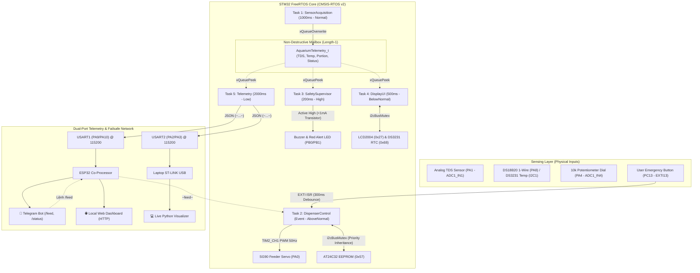

# 🐠 Aquatic Guardian — Smart Fish Tank Controller & Feeder

[](https://www.st.com/)
[](https://www.freertos.org/)
[](https://telegram.org/)
[](https://fpt.edu.vn/)


> **MCP201 (Microcontroller Programming) — Capstone Project**  
> **FPT University — Semester 3 — Class: IC2005 — Group 7**  
> *Target Hardware: STM32F401RE / STM32F411RE Nucleo-64 + ESP32-WROOM-32 Co-Processor*

---

## 🌊 Overview & Core Mission

Maintaining an aquatic ecosystem requires constant, round-the-clock monitoring of three vital factors:
1. **Water Quality (TDS)**: Total Dissolved Solids must remain within a safe range ($\le 350\text{ ppm}$); sudden accumulation of organic waste or mineral overload poses lethal toxicity to aquatic life.
2. **Water Temperature**: Must stay within the biological tolerance zone ($24^\circ\text{C} - 28^\circ\text{C}$).
3. **Nutrition & Dispensing**: Feeding must occur strictly on schedule and with measured portions. Underfeeding causes starvation, while overfeeding decomposes rapidly and pollutes the water.

**Aquatic Guardian** is a **Distributed Dual-MCU Embedded System** that replaces manual aquarium care:
* **Real-Time Core (STM32 Nucleo)**: Executes **FreeRTOS (CMSIS-RTOS v2)** for deterministic, multi-tasking sensor sampling, $O(1)$ ring filtering, dynamic PWM dispensing, safety supervision, and battery-backed logging.
* **IoT & Telemetry Co-Processor (ESP32)**: Dedicated Wi-Fi bridge providing an interactive **Telegram Bot**, automated emergency push notifications, and a local responsive **Web Dashboard**.

---

## 🏛️ System Architecture



---

## 📌 Conflict-Free Pin Mapping Table

| Peripheral | Component / Sensor | Pin / Header | Alternate Function | Technical Specifications & Hardware Protection |
| :--- | :--- | :---: | :--- | :--- |
| **ADC1_IN1** | Analog TDS Sensor V1.0 | **`PA1`** (A1) | Analog In | 0 – 3.3V linear range, 0.1µF capacitor to GND |
| **ADC1_IN4** | Dosage Potentiometer | **`PA4`** (A2) | Analog In | 10kΩ voltage divider (1g – 15g portion mapping) |
| **GPIO / 1-Wire**| Waterproof DS18B20 | **`PA8`** (D7) | GPIO_Output_OD | 1-Wire protocol with 4.7kΩ external pull-up to 3.3V |
| **TIM2_CH1** | SG90 Feeder Servo | **`PA0`** (A0) | AF1 (TIM2_CH1) | 50Hz PWM (ARR=19999, PSC=83). 1ms ($0^\circ$) to 2ms ($180^\circ$) |
| **I2C1_SCL** | LCD2004 + DS3231 RTC | **`PB8`** (D15) | AF4 (I2C1_SCL) | Shared I2C Clock with 4.7kΩ pull-up |
| **I2C1_SDA** | LCD2004 + DS3231 RTC | **`PB9`** (D14) | AF4 (I2C1_SDA) | Shared I2C Data with 4.7kΩ pull-up |
| **USART1_TX** | ESP32 Wi-Fi RX | **`PA9`** (D8) | AF7 (USART1_TX) | 115200 bps, 8N1 to ESP32 GPIO16 (RX2) |
| **USART1_RX** | ESP32 Wi-Fi TX | **`PA10`** (D2) | AF7 (USART1_RX) | 115200 bps, 8N1 from ESP32 GPIO17 (TX2) |
| **USART2_TX** | ST-LINK USB VCP | **`PA2`** (VCP) | AF7 (USART2_TX) | 115200 bps to Laptop Terminal / Python visualizer |
| **USART2_RX** | ST-LINK USB VCP | **`PA3`** (VCP) | AF7 (USART2_RX) | 115200 bps from Laptop Terminal |
| **EXTI13** | Blue User Button (B1) | **`PC13`** | GPIO Input | Falling edge trigger, 300ms software tick debounce |
| **GPIO Out** | Active Buzzer (3-Pin) | **`PB0`** (A3) | GPIO_Output | High = ON; uses 3-pin module with onboard transistor (<1mA) |
| **GPIO Out** | Status Green LED | **`PA5`** (D13) | GPIO_Output | Solid = Normal Healthy Operation |
| **GPIO Out** | Hazard Red Alert LED | **`PB1`** (D6) | GPIO_Output | Flashes at 1Hz on Critical Water Alert / Overheat |
| **GPIO Out** | Pump Relay 5V | **`PB4`** (D5) | GPIO_Output | 5V Relay with H/L jumper set to HIGH trigger (or Open-Drain) |

---

## ⚡ FreeRTOS Multi-Tasking Architecture

| Task Identifier | Priority | Period / Trigger | Stack (Bytes) | Inter-Process Communication (IPC) & Responsibilities |
| :--- | :--- | :--- | :---: | :--- |
| **`Task_SafetySupervisor`** | `osPriorityHigh` (32) | 200 ms | 1024 | Non-destructively peeks mailbox. Triggers buzzer & LED alert if TDS > 500ppm or Temp > 32°C. |
| **`Task_DispenserControl`** | `osPriorityAboveNormal` (24) | Event-Driven | 1024 | Blocks on `feedTriggerSemHandle`. Rotates SG90 servo ($90^\circ$ dispense), locks `i2cBusMutex` to write feed log into AT24C32 EEPROM. **(Priority Inheritance Proof)** |
| **`Task_SensorAcquisition`** | `osPriorityNormal` (16) | 1000 ms | 1024 | Dynamic ADC sampling (`PA1`, `PA4`), 20-sample circular filter ($O(1)$ sum), cubic polynomial TDS calculation, updates length-1 mailbox via `xQueueOverwrite()`. |
| **`Task_DisplayUI`** | `osPriorityBelowNormal` (12) | 500 ms | 2048 | Peeks mailbox, locks `i2cBusMutex`, reads BCD time from DS3231 RTC, updates LCD2004 display. |
| **`Task_Telemetry`** | `osPriorityLow` (8) | 2000 ms | 2048 | Peeks mailbox, locks `uartMutexHandle`, broadcasts `~` framed JSON telemetry concurrently to `USART1` (ESP32) and `USART2` (Laptop ST-LINK). |

---

## 📂 Repository File Tree

```text
mcp201-aquatic-guardian/
├── README.md                                 # Primary repository overview & quick start
├── AQUATIC_GUARDIAN_MASTER_BRIEF.md          # Comprehensive master engineering brief
├── AQUATIC_GUARDIAN_BIG_PICTURE.md           # High-level architecture & 5-minute demo script
├── AQUATIC_GUARDIAN_SPEC.md                  # State machines, timing & algorithm specification
├── Aquatic_Guardian_Task_Tracker.xlsx        # 8-tab task tracking workbook (Google Sheets compatible)
├── .gitignore                                # Build & temporary file exclusions
│
├── docs/                                     # In-depth architectural & hardware documentation
│   ├── hardware_bom_shopping_list.md         # Detailed BOM & 6 critical hardware pitfall fixes
│   ├── pinout_wiring.md                      # Complete wiring & conflict-free pin mapping
│   ├── presentation_rubric_guide.md          # 5-minute defense script & top rubric Q&A
│   ├── project_and_presentation_plan.md      # Engineering milestones & presentation timeline
│   ├── team_work_split.md                    # 5-member work allocation & deliverables
│   ├── reference_repo_analysis.md            # Analysis of base thesis repository
│   └── owner_documentation_breakdown.md      # Deep-dive into Quattrone's 1049-paragraph thesis
│
├── src/                                      # Embedded STM32 FreeRTOS C Application
│   ├── aquatic_guardian_app.h                # Core application header & data structures
│   ├── aquatic_guardian_app.c                # Full FreeRTOS implementation + I2C/PWM drivers
│   └── standalone_tests/                     # Self-contained 5-minute hardware verification suite
│       ├── test_servo_pwm.c                  # Member 3: SG90 PWM 50Hz sweep test
│       ├── test_tds_filter.c                 # Member 2: Dynamic ADC & 20-sample ring filter
│       ├── test_i2c_scanner.c                # Member 4: I2C1 127-address scanner & RTC/EEPROM test
│       └── test_uart_esp32_bridge.c          # Member 5: Dual UART JSON framing & loopback test
│
├── esp32/                                    # IoT Co-Processor Firmware
│   └── esp32_aquatic_bridge.ino              # Arduino C++ sketch: Telegram Bot + Web Dashboard
│
└── scripts/                                  # PC Utilities & Automation
    ├── aquatic_pc_bridge.py                  # Laptop ST-LINK USB live terminal visualizer
    └── generate_task_tracker.py              # Automation script generating the 8-tab workbook
```

---

## 🚀 Quick Start Guide

### 1. STM32 Firmware (STM32CubeIDE)
1. Create a new STM32CubeIDE project for **STM32F401RE** or **STM32F411RE** with **FreeRTOS (CMSIS-RTOS v2)** enabled.
2. Configure peripherals in CubeMX as defined in [`docs/pinout_wiring.md`](docs/pinout_wiring.md):
   * `ADC1`: IN1 (`PA1`), IN4 (`PA4`)
   * `TIM2`: Channel 1 PWM Generation (`PA0`) with $\text{PSC}=83$, $\text{ARR}=19999$ ($50\text{Hz}$)
   * `I2C1`: SCL (`PB8`), SDA (`PB9`) @ 100 kHz Standard Mode
   * `USART1`: Asynchronous (`PA9` TX, `PA10` RX) @ 115200 bps
   * `USART2`: Asynchronous (`PA2` TX, `PA3` RX) @ 115200 bps
   * `EXTI13`: GPIO External Interrupt Falling Edge (`PC13`)
3. Copy [`src/aquatic_guardian_app.h`](src/aquatic_guardian_app.h) into `Core/Inc/` and [`src/aquatic_guardian_app.c`](src/aquatic_guardian_app.c) into `Core/Src/`.
4. Call `AquaticGuardian_Init()` before `osKernelStart()` in `main.c`.
5. Build and flash via onboard ST-LINK debugger.

### 2. ESP32 Wi-Fi & Telegram Bot (Arduino IDE)
1. Open [`esp32/esp32_aquatic_bridge.ino`](esp32/esp32_aquatic_bridge.ino) in Arduino IDE.
2. Install required libraries: `UniversalTelegramBot` and `ArduinoJson` (v6 or v7).
3. Set your phone hotspot credentials (`WIFI_SSID`, `WIFI_PASSWORD`) and Telegram Bot Token (`BOT_TOKEN`).
4. Select board **ESP32 Dev Module**, connect USB cable, and click **Upload**.
5. Connect `GPIO16` (RX2) to STM32 `PA9` (TX1) and `GPIO17` (TX2) to STM32 `PA10` (RX1) with shared GND.

### 3. PC Laptop Failsafe Visualizer (Python)
1. Connect the Nucleo board to your laptop via USB ST-LINK.
2. Install dependencies:
   ```bash
   pip install pyserial colorama
   ```
3. Run the live telemetry bridge:
   ```bash
   python scripts/aquatic_pc_bridge.py
   ```

---

## 📜 Academic Lineage & License

* **Base Reference**: Derived and substantially upgraded from the academic thesis *"Fish Tank Guardian"* by Martín Quattrone (FIUBA - University of Buenos Aires, 2023), based on the official ARM textbook by Ariel Lutenberg.
* **Architecture v2.0 Upgrades**:
  * Upgraded single-threaded polling to preemptive **FreeRTOS (CMSIS-RTOS v2)**.
  * Resolved 8 critical pinout collisions and multi-consumer queue starvation defects.
  * Introduced dual-mode telemetry (ESP32 IoT Bonus + ST-LINK USB Failsafe).
  * Validated genuine **Priority Inheritance** on the shared I2C1 bus between `Task_DispenserControl` and `Task_DisplayUI`.
* **License**: Open-source educational project for FPT University MCP201 Capstone.
