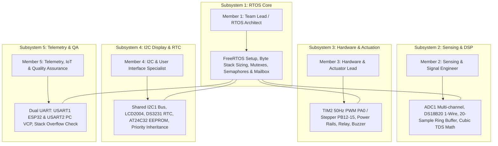

# 📋 Aquatic Guardian — Master Project & Presentation Plan
## Work Breakdown Structure (WBS) for 5-Member Team (MCP201)

> **Project**: Aquatic Guardian (Smart Fish Tank Feeder & Water Purity Supervisor)  
> **Target**: MCP201 Capstone Project (30% Course Weight)  
> **Team**: Group 7 (5 Members)

---

## 🏗️ SECTION 1: THE PROJECT IMPLEMENTATION (Firmware & Hardware)

The engineering workflow is partitioned into 5 modular subsystems that run concurrently during Phase 1 & 2 before merging into the unified FreeRTOS firmware:

### Module Deliverables & Assignment

| Member & Primary Role | Engineering Tasks | Key Source Files | Milestone Target |
| :--- | :--- | :--- | :--- |
| **Member 1** *(Team Lead & RTOS Architect)* | 1. Configure STM32CubeMX project (`.ioc`) with FreeRTOS (CMSIS-RTOS v2) and HAL Timebase on TIM5. 2. Define 5 tasks with explicit **byte stack sizing** (`1024 bytes` core, `2048 bytes` Display/Telemetry). 3. Implement inter-task communication: `feedTriggerSem`, `i2cBusMutex`, `uartMutex`, and **Length-1 Non-Destructive Mailbox** (`xQueueOverwrite` + `xQueuePeek`) eliminating task starvation. 4. Implement `AquaticGuardian_OnButtonPressed_ISR(PC13)` with 300ms software tick debounce guard. 5. Integrate all modules into `main.c` / `aquatic_guardian_app.c` and manage Git repo. | `aquatic_guardian_app.c/.h` `freertos.c` `main.c` | **Day 3** (Skeleton) **Day 7** (Integrated) |
| **Member 2** *(Sensing & Signal Processing)* | 1. Configure ADC1 dynamic channel polling (PA1 for TDS, PA4 for Potentiometer) preventing `ADC1->DR` overwrite. 2. Implement 1-Wire driver on `PA8` for Waterproof DS18B20 with 4.7kΩ pull-up. 3. Implement 20-sample Ring Buffer Moving Average Filter to suppress water ripples. 4. Code exact cubic TDS formula: $\text{TDS} = (133.42V_{\text{comp}}^3 - 255.86V_{\text{comp}}^2 + 857.39V_{\text{comp}}) \times 0.5$ with $V_{\text{comp}} = V_{\text{adc}} / [1.0 + 0.02(T - 25.0)]$. 5. Unit test raw ADC vs voltage vs PPM accuracy with 2 water samples. | `tds_sensor.c/.h` `ds18b20.c/.h` `adc_dsp.c/.h` | **Day 4** (Sensor Verified) |
| **Member 3** *(Hardware & Actuation Lead)* | 1. Configure TIM2_CH1 ($50\text{ Hz}$ PWM, 1ms–2ms pulse) on `PA0` with 84 MHz APB1 timer clock (`PSC = 83`, `ARR = 19999`). Fallback: Stepper 28BYJ-48 on `PB12–PB15` (clearing `PB8`/`PB9` for I2C1). 2. Build external 5V power rail with common GND to prevent MCU brownout resets. 3. Assemble mechanical dispenser rotary bottle-cap mechanism. 4. Wire Active 5V Buzzer (`PB0`), Red Hazard LED (`PB1`), and Optocoupled Relay (`PB4`). | `servo_feeder.c/.h` `stepper_motor.c/.h` `hardware_wiring.md` | **Day 4** (Actuators Verified) |
| **Member 4** *(I2C Bus & UI / RTC Specialist)* | 1. Implement PCF8574 LCD2004 / 1602 4-bit I2C driver on `I2C1` (`PB8` SCL, `PB9` SDA). 2. Implement DS3231 RTC reader over I2C1 (`0x68`) with single-shot minute guard. 3. Implement AT24C32 EEPROM driver (`0x57`, pages 0–4) for schedule and feed log persistence. 4. Verify **Priority Inheritance** proof on `i2cBusMutex`: `Task_DispenserControl` (`osPriorityAboveNormal`) logging to EEPROM vs `Task_DisplayUI` (`osPriorityBelowNormal`) updating LCD/RTC. | `lcd_pcf8574.c/.h` `ds3231_rtc.c/.h` `eeprom_at24c32.c/.h` | **Day 5** (Display Verified) |
| **Member 5** *(Telemetry, IoT & QA Engineer)* | 1. Implement dedicated Dual UART architecture: `USART1` (`PA9`/`PA10` @ 115200 bps) for ESP32 Wi-Fi bridge with `~` delimiter framing; `USART2` (`PA2`/`PA3`) for PC ST-LINK Virtual COM Port. 2. Flash `Esp32.ino` for Telegram Bot commands (`/feed`, `/status`, emergency alerts). 3. Build PC Serial Test Dashboard (`aquatic_pc_dashboard.py`) for offline live monitoring. 4. Enable `configCHECK_FOR_STACK_OVERFLOW = 2` and stress test system stability. 5. Record 2-minute 4K backup demonstration video. | `telemetry_uart.c/.h` `Esp32.ino` `qa_test_report.md` `demo_backup_video.mp4` | **Day 6** (Telemetry & Stability) |

---

## 🎤 SECTION 2: THE PRESENTATION & DEFENSE (30% Evaluation)

The capstone defense consists of an **8–10 minute group presentation**, a **live hardware demonstration**, and a **teacher Q&A defense session**.

### 1. Slide Deck Structure (10 Slides Total)

### 1. Slide Deck Structure (10 Slides Total)

| Time Window | Presentation Phase | Speaker | Focus Content |
| :---: | :--- | :--- | :--- |
| **00:00 – 02:00** | Problem Statement & System Architecture | **Member 1 (Lead)** | Slides 1–4: Aquarium risks, Block diagram, FreeRTOS 5 tasks, Priority hierarchy |
| **02:00 – 03:30** | Sensing, Signal Processing & Calibration | **Member 2** | Slide 5: ADC1 dynamic polling, 20-sample ring buffer, cubic TDS formula |
| **03:30 – 05:00** | Hardware Actuation & Power Design | **Member 3** | Slide 6: TIM2 PWM (PSC=83, ARR=19999 @ 84MHz), Stepper PB12-15, 5V power rail |
| **05:00 – 06:30** | I2C UI, RTC Timekeeping & Persistence | **Member 4** | Slide 7: Shared I2C1 (PB8/PB9), LCD2004, DS3231, AT24C32, Priority Inheritance |
| **06:30 – 08:00** | Telemetry, Testing & Safety Supervision | **Member 5** | Slides 8–10: Dual UART (USART1/USART2), ESP32 Telegram Bot, QA High Water Mark |
| **08:00 – 10:00** | Live Hardware Demonstration | **All Members** | 4-Stage Live Demo (Normal $\to$ Manual Feed $\to$ Hazard Alarm $\to$ Portion Pot) |
| **10:00 – 15:00** | Teacher Technical Q&A Defense | **All Members** | Technical defense covering RTOS kernel, DSP, Timers, I2C, and UART |

* **Slide 1**: Title, Group 7 Members, Student IDs, Project Name (**Aquatic Guardian**).
* **Slide 2**: Problem Statement & Practical Need (aquarium maintenance, feeding negligence, water contamination).
* **Slide 3**: End-to-End System Block Diagram (Sensors $\to$ STM32 $\to$ FreeRTOS $\to$ Actuators/UI/Cloud).
* **Slide 4**: FreeRTOS Multitasking Architecture (5 tasks, byte stack sizing, priority matrix, Length-1 Non-Destructive Mailbox).
* **Slide 5**: Sensing Subsystem: ADC1 dynamic channel polling (PA1/PA4), 20-sample circular ring buffer, DS18B20 1-Wire (PA8), and cubic TDS calibration formula.
* **Slide 6**: Actuation & Hardware: TIM2 PWM Servo calculations (84 MHz, PSC=83, ARR=19999), 28BYJ-48 Stepper (PB12-PB15), power rail isolation, and relay pump.
* **Slide 7**: Shared I2C Bus & Persistence: LCD2004 (`0x27`), DS3231 RTC (`0x68`), AT24C32 EEPROM (`0x57`), and Priority Inheritance proof on `i2cBusMutex`.
* **Slide 8**: Real-time Concurrency & Race Condition Prevention (EXTI13 300ms software tick debounce $\to$ `feedTriggerSem`, `uartMutex`).
* **Slide 9**: Telemetry & IoT: Dual UART architecture (USART1 for ESP32 with `~` framing, USART2 for PC VCP), Telegram Bot, and PC dashboard.
* **Slide 10**: Summary, QA Stress Testing (`configCHECK_FOR_STACK_OVERFLOW = 2`), Lessons Learned & Future Extensions.

---

### 2. Member Roles in the Presentation & Defense

| Member | Presentation Speaking Segment | Live Demo Responsibility | Q&A Defense Focus Domain |
| :--- | :--- | :--- | :--- |
| **Member 1** *(Lead)* | Introduction, System Architecture & FreeRTOS Scheduling (Slides 1–4). | Moderates the demo flow; introduces test scenarios to teacher. | FreeRTOS Kernel, Task States, Context Switching, Priority Inheritance, Mailbox non-destructive read. |
| **Member 2** | Sensing Subsystem, ADC Linearity, 20-Sample Filter & Cubic TDS Formula (Slide 5). | Dips TDS probe into clean vs salted water to trigger live reading shift. | ADC Dynamic Polling (preventing DR overwrite), Resolution ($2^{12}$), 20-sample Ring Buffer, DS18B20 1-Wire. |
| **Member 3** | Motor Actuation, PWM Timers & Power Safety (Slide 6). | Operates manual feed button (`PC13` debounced) and turns portion potentiometer. | Timer Prescaler/ARR formula (84MHz APB1, PSC=83, ARR=19999), Servo duty cycle (1–2ms), Stepper PB12–PB15, Common GND. |
| **Member 4** | I2C Protocol, LCD2004 UI, RTC & EEPROM Persistence (Slide 7). | Directs camera/teacher attention to LCD screen updates during events. | I2C Start/Stop, 7-bit addressing (`0x27`, `0x68`, `0x57`), Single-shot minute guard, Mutex Priority Inheritance. |
| **Member 5** | Dual UART, ESP32 Telegram Bot, QA & Conclusion (Slides 8–10). | Shows PC Serial Monitor receiving live JSON packets (`~` framing); runs backup video. | Dual UART routing (USART1 vs USART2), Idle frame RX, Buffer overflow prevention, Stack High Water Mark. |

---

## 🛡️ 3. Risk Mitigation & Backup Strategy

> [!IMPORTANT]
> **The Golden Rule of Live Demos:** If something can fail, it will fail in front of the instructor. We prepare 3 redundant failsafes:

1. **Backup 4K Demonstration Video (Member 5)**:
   * Prior to the presentation day, record a clear 2-minute video demonstrating all 4 features (Normal operation, Manual feed, High TDS alarm, Potentiometer adjustment).
   * If physical hardware suffers a loose jumper wire in class, play the video immediately without losing presentation flow.
2. **Pre-calibrated Water Samples (Member 2)**:
   * Bring two clearly labeled cups: Cup A (Clean tap water ~120 ppm), Cup B (Water with a pinch of table salt ~600 ppm) for instantaneous, reliable alarm demonstration.
3. **Dedicated Power Bank (Member 3)**:
   * Never rely solely on laptop USB power. Bring a 5V power bank with a dual USB breakout to guarantee steady voltage for both the Nucleo board and the servo motor.

---

## 📅 4. 2-Week Sprint Schedule

| Days | Phase | Target Objectives | Responsible |
| :---: | :--- | :--- | :---: |
| **Days 1–3** | **CubeMX & Drivers** | Generate `.ioc`, build standalone drivers for ADC, PWM, I2C, UART. | All (Parallel) |
| **Days 4–6** | **FreeRTOS Integration** | Merge drivers into FreeRTOS tasks; verify Semaphore & Mutex. | M1, M2, M3 |
| **Days 7–8** | **Full System Benchmarking** | Assemble mechanical feeder, test continuous 24h run, check heap/stack. | M3, M4, M5 |
| **Days 9–10** | **Slide Deck & Scripting** | Draft 10 slides; write exact speaking scripts for each member. | M4, M5, M1 |
| **Days 11–12** | **Dry-Run Rehearsals** | 2 full mock presentations with 10-minute timer and simulated Q&A. | All Members |
| **Day 13** | **Video Backup Recording** | Shoot high-res demo video; finalize IEEE report/documentation. | M5, M1 |
| **Day 14** | **Final Defense Day** | Deliver presentation, live demo, and ace instructor questions. | All Members |

