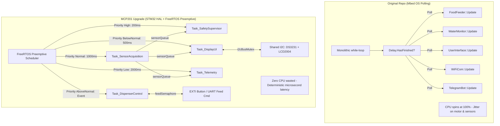

# 🔬 Reference Repository Analysis: FishTankGuardian
## Comparative Architectural Study: Mbed OS Polling vs. STM32 FreeRTOS (MCP201)

> **Reference Repository**: [`martinquattro/FishTankGuardian`](https://github.com/martinquattro/FishTankGuardian)  
> **Course Requirement**: MCP201 Embedded Systems Capstone (STM32CubeIDE · STM32 HAL · FreeRTOS)

---

## 📌 1. High-Level Comparison & Architectural Upgrade

The original repository (`martinquattro/FishTankGuardian`) was developed under **Mbed OS** using a cooperative polling state machine (`while(true) { Update(); }`). For the **MCP201 course capstone**, our team ports and upgrades this into a **preemptive real-time multitasking architecture (FreeRTOS / CMSIS-RTOS v2)** with STM32 HAL drivers.



---

## 🧩 2. Subsystem Mapping: Reference vs. MCP201 Implementation

| Subsystem | Reference Repo (`martinquattro`) | MCP201 Implementation (Group 7) | Why This Wins High Marks in Defense |
| :--- | :--- | :--- | :--- |
| **OS / Runtime** | Mbed OS cooperative soft-timer polling | Preemptive **FreeRTOS (CMSIS-RTOS v2)** | Directly fulfills **CLO 8, 9, 10** for RTOS multitasking. |
| **Microcontroller** | NUCLEO-F429ZI | ST Nucleo-F401RE / F411RE / F429ZI | Standardized on ARM Cortex-M4 ST Nucleo family. |
| **Feeder Actuator** | 28BYJ-48 Stepper + ULN2003 | SG90 Servo (**TIM2 PWM `PA0`**, PSC=83, ARR=19999 @ 84MHz) / Stepper (**`PB12–PB15`**) | Demonstrates Timer PWM calculation (`PSC`, `ARR`, `CCR`) avoiding I2C pins. |
| **Water Purity** | Analog TDS Sensor (ADC) | ADC1 Dynamic Polling + **20-sample Ring Buffer Filter** | Eliminates wave ripple noise; exact cubic temperature-compensated formula. |
| **Temperature** | Potentiometer / DS18B20 | Waterproof **DS18B20 (1-Wire on `PA8`)** with 4.7kΩ pull-up | Accurate water temperature for TDS compensation. |
| **Time & Storage** | Tiny RTC (DS1307 / DS3231) + AT24C32 EEPROM | DS3231 Precision I2C RTC (`0x68`) + **AT24C32 EEPROM (`0x57`)** | Manages feeding schedule and logs feed timestamps with Priority Inheritance. |
| **Display** | LCD 20x4 (HD44780 + I2C Backpack) | LCD 1602 / 2004 with PCF8574 I2C adapter | Shared physical bus protected by FreeRTOS Mutex. |
| **Connectivity** | ESP32 WROOM (Telegram Bot bridge) | **Dual UART**: ESP32 Wi-Fi on **`USART1`** (`PA9`/`PA10`) with `~` delimiter framing + PC VCP on **`USART2`** (`PA2`/`PA3`) | Eliminates serial bus driver contention and debug pollution. |

---

## 🤖 3. The Telegram Bot Bridge (ESP32 Co-Processor)

In our v2.0 Architecture, an **ESP32** operates as a network co-processor connected to the STM32 via dedicated **`USART1`** (`PA9` TX / `PA10` RX @ `115200 bps`), while **`USART2`** (`PA2`/`PA3`) is dedicated to the PC ST-LINK Virtual COM Port. It handles Wi-Fi connection and the Telegram Bot API:

```
[User Telegram App] <==== HTTPS ====> [ESP32 WiFi] <==== USART1 (PA9/PA10) ====> [STM32 Nucleo (FreeRTOS)]
                                                                               |
                                                                               +<==== USART2 (PA2/PA3) ====> [PC Terminal]
```

### Supported Remote Commands:
1. `/feed` $\to$ Sends `FEED` command to STM32 over UART $\to$ STM32 unblocks `Task_DispenserControl` via semaphore $\to$ Dispenses food.
2. `/status` $\to$ Requests latest telemetry from STM32 $\to$ STM32 returns `{"tds": 180, "temp": 26.5}` $\to$ ESP32 replies to Telegram chat.
3. `/set_schedule <HH:MM>` $\to$ Configures automated feeding time in RTC memory.
4. `AUTOMATIC ALERT` $\to$ If STM32 detects $\text{TDS} > 500\text{ ppm}$, it transmits `ALERT:HIGH_TDS` to ESP32 $\to$ ESP32 sends urgent warning message to user's Telegram.

---

## 💡 4. What This Means for Your 5 Team Members

Having the reference repository makes your team's division of labor much easier to build:

1. **Member 1 (RTOS Kernel)**: Converts the Mbed polling loops into 5 preemptive FreeRTOS tasks with Mutex & Semaphores.
2. **Member 2 (Sensing & DSP)**: Adapts `tds_sensor.cpp` & `temperature_sensor.cpp` into clean STM32 HAL ADC drivers.
3. **Member 3 (Actuator & Motor)**: Replicates the 28BYJ-48 stepper sequence or adapts to SG90 Servo PWM.
4. **Member 4 (I2C UI & RTC)**: Reuses the LCD 2004 layout and DS3231 I2C logic with `i2cBusMutex`.
5. **Member 5 (Telemetry & Telegram Bot)**: Flashes the provided `Esp32.ino` sketch to an ESP32 or creates a Python PC Dashboard simulating Telegram commands.

