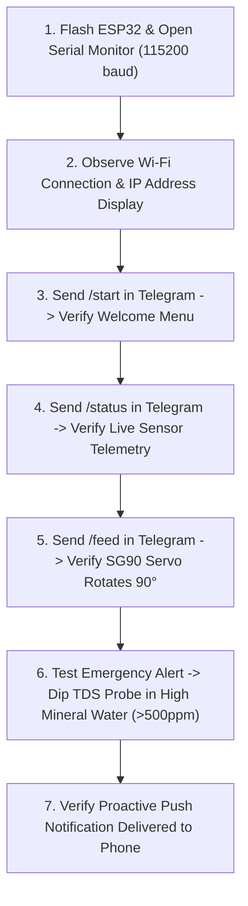

# 🤖 Aquatic Guardian — Telegram Bot & IoT Setup Guide

> **Course**: MCP201 (Microprocessor & Embedded Systems Capstone)  
> **Project**: Aquatic Guardian — Smart Fish Tank Controller & Feeder  
> **Target Subsystem**: ESP32 Wi-Fi & Telegram IoT Co-Processor (`esp32/esp32_aquatic_bridge.ino`)  
> **Target Hardware**: ESP32-WROOM-32 / ESP32 NodeMCU + ST Nucleo-F401RE / F411RE

---

## 📑 Table of Contents
1. [System Architecture & Data Flow](#-1-system-architecture--data-flow)
2. [Creating the Telegram Bot with @BotFather](#-2-creating-the-telegram-bot-with-botfather)
3. [Retrieving Your Personal Telegram User ID (Chat ID)](#-3-retrieving-your-personal-telegram-user-id-chat-id)
4. [Arduino IDE Setup & Required Libraries](#-4-arduino-ide-setup--required-libraries)
5. [Configuring `esp32_aquatic_bridge.ino`](#-5-configuring-esp32_aquatic_bridgeino)
6. [Hardware Interfacing (ESP32 to STM32 Nucleo)](#-6-hardware-interfacing-esp32-to-stm32-nucleo)
7. [Verification & Testing Checklist](#-7-verification--testing-checklist)
8. [Troubleshooting Common Issues](#-8-troubleshooting-common-issues)
9. [Quick Reference Cheat Sheet](#-9-quick-reference-cheat-sheet)

---

## 🌐 1. System Architecture & Data Flow

In the **Aquatic Guardian** ecosystem, the ESP32 operates as an autonomous **IoT Co-Processor** bridged to the main STM32F4 Real-Time Microcontroller.

```mermaid
flowchart LR
    subgraph Cloud["Telegram Cloud Infrastructure"]
        TG["Telegram API Server<br/>(api.telegram.org:443)"]
    end

    subgraph User["User Interface"]
        Phone["📱 Smartphone / Telegram App<br/>(User / Evaluator)"]
    end

    subgraph ESP["ESP32 IoT Co-Processor"]
        ESP_CORE["ESP32-WROOM-32<br/>(UniversalTelegramBot + WiFiClientSecure)"]
        WEB["Local HTTP Web Server<br/>(Port 80 Dashboard)"]
    end

    subgraph STM["STM32 Real-Time Controller"]
        STM_CORE["STM32 Nucleo-F401RE<br/>(FreeRTOS Kernel)"]
        SENSORS["🌊 Sensors: Analog TDS & DS18B20 Temp"]
        ACTUATORS["⚙️ Actuators: SG90 Servo, Buzzer, LCD, Relay"]
    end

    Phone <-->|HTTPS Commands & Push Alerts| TG
    TG <-->|Encrypted TLS (Port 443)| ESP_CORE
    ESP_CORE <-->|Framed UART2: ~feed~ / ~status~ / JSON Telemetry<br/>115200 bps (PA9/PA10)| STM_CORE
    STM_CORE --- SENSORS
    STM_CORE --- ACTUATORS
    Phone -.->|Local Wi-Fi Browser| WEB
```

### Two-Way Communication Channels
1. **Downlink (User $\to$ STM32)**: User issues `/feed` or `/status` in Telegram $\to$ Telegram Server $\to$ ESP32 polling loop $\to$ Framed command string (`~feed~` or `~status~`) over UART2 $\to$ STM32 FreeRTOS `Task_DispenserControl` triggers SG90 servo dispenser.
2. **Uplink (STM32 $\to$ User)**: STM32 periodically sends JSON telemetry (`{"time":42,"tds_ppm":530.0,"portion_g":5,"temp_c":26.2,"status":2}`) over UART2 $\to$ ESP32 parses packet with `ArduinoJson` $\to$ If `status == 2` (Critical TDS > 500 ppm), ESP32 **proactively sends an emergency push notification** directly to your personal Chat ID!

---

## 🤖 2. Creating the Telegram Bot with @BotFather

**BotFather** is the official Telegram bot that automates the creation and management of all Telegram bots.

```
+---------------------------------------------------------------+
|                        TELEGRAM APP                           |
|                                                               |
|  User:        /newbot                                         |
|  BotFather:   Alright, a new bot. How are we going to call it?|
|  User:        Aquatic Guardian Bot                            |
|  BotFather:   Good. Now let's choose a username for your bot. |
|  User:        AquaticGuardian_mcp201_bot                      |
|  BotFather:   Done! Congratulations on your new bot...        |
|               Use this token to access the HTTP API:          |
|               7123456789:AAFlkjdf9834kjhkjfds87sdf98sd7f      |
+---------------------------------------------------------------+
```

### Step-by-Step Instructions:

1. **Open Telegram**:
   * Open the Telegram desktop application or mobile app on iOS/Android.
2. **Search for BotFather**:
   * In the top search bar, type `@BotFather`.
   * Look for the account with the **verified blue checkmark badge** next to its name. Beware of impostor accounts without the blue badge.
3. **Start the Conversation**:
   * Click **Start** (or send `/start`).
4. **Create a New Bot**:
   * Send the command:
     ```text
     /newbot
     ```
5. **Set the Display Name**:
   * BotFather will prompt: *"Alright, a new bot. How are we going to call it? Please choose a name for your bot."*
   * Enter a friendly display name (this appears at the top of your chat window), for example:
     ```text
     Aquatic Guardian Monitor
     ```
6. **Set the Unique Username**:
   * BotFather will prompt: *"Good. Now let's choose a username for your bot. It must end in `bot`. Like this, for example: TetrisBot or tetris_bot."*
   * Enter a unique handle. It **must** end in `bot` or `_bot` (case-insensitive).
   * Examples:
     * `AquaticGuardian_mcp201_bot`
     * `FishTank_Group7_bot`
     * `Aquatic_Guardian_2026_bot`
   * *Note: If BotFather says "Sorry, this username is already taken", try adding your team group number or initials.*
7. **Copy Your HTTP API Token**:
   * BotFather will output a congratulatory message containing your **HTTP API Token**.
   * It looks like this:
     ```text
     7123456789:AAFlkjdf9834kjhkjfds87sdf98sd7f
     ```
   * Save this token in a temporary secure note.

> [!WARNING]
> **Token Security Notice**:  
> Anyone who possesses this HTTP API Token has full control over your bot. Never commit this token to a public GitHub repository. In your team repository, keep it in an uncommitted local header or replace with placeholder text prior to pushing.

---

## 🆔 3. Retrieving Your Personal Telegram User ID (Chat ID)

### Why Do We Need Your Personal Chat ID?
By default, Telegram bots cannot initiate unsolicited conversations with random people (to prevent spam). When a critical water quality emergency occurs (TDS > 500 ppm), the ESP32 must know **exactly who to alert**. Specifying your personal Chat ID allows the ESP32 to proactively dispatch an alert banner directly to your phone.

### Method A: Using `@userinfobot` (Recommended — Fastest)
1. In the Telegram search bar, search for `@userinfobot`.
2. Click **Start** (or send `/start`).
3. The bot will immediately reply with your profile information:
   ```text
   @userinfobot:
   Id: 987654321
   First: John
   Last: Doe
   Lang: en
   ```
4. Copy the numeric number next to **`Id:`** (e.g. `987654321`). This is your `AUTHORIZED_CHAT_ID`.

### Method B: Using `@RawDataBot` (Alternative)
1. Search for `@RawDataBot` in Telegram.
2. Click **Start**.
3. It replies with a JSON dump of your account. Locate the section:
   ```json
   "from": {
       "id": 987654321,
       "is_bot": false,
       "first_name": "John"
   }
   ```
4. Copy the value of `"id"`.

> [!IMPORTANT]
> **The First Contact Rule**:  
> Before your bot can send you messages, you **must open your newly created bot in Telegram** (search for `@YourBotUsername`) and click **START** or send `/start`. This authorizes the bot to deliver push alerts to your account!

---

## 💻 4. Arduino IDE Setup & Required Libraries

To compile and flash `esp32_aquatic_bridge.ino`, you need the Arduino IDE configured with the ESP32 core and two specialized libraries.

### 4.1 Board Core Installation
1. Open **Arduino IDE** (v2.x recommended).
2. Go to **File $\to$ Preferences** (or `Ctrl + ,`).
3. In **Additional boards manager URLs**, add:
   ```text
   https://raw.githubusercontent.com/espressif/arduino-esp32/gh-pages/package_esp32_index.json
   ```
4. Go to **Tools $\to$ Board $\to$ Boards Manager...** (or click the board icon on the left sidebar).
5. Search for `esp32` by **Espressif Systems** and click **Install**.
6. Select your board:
   * **Tools $\to$ Board $\to$ esp32 $\to$ ESP32 Dev Module** (or **NodeMCU-32S**).

---

### 4.2 Installing Required Libraries via Library Manager
Press `Ctrl + Shift + I` (or navigate to **Sketch $\to$ Include Library $\to$ Manage Libraries...**):

```
+-------------------------------------------------------------------------+
| Library Manager                                                     [X] |
+-------------------------------------------------------------------------+
| Filter: UniversalTelegramBot                                            |
|                                                                         |
| UniversalTelegramBot by Brian Lough                       [ INSTALL ]   |
| An Arduino library for using the Telegram Bot API on ESP8266 and ESP32. |
| Version: 1.3.0 (or latest)                                              |
+-------------------------------------------------------------------------+
| Filter: ArduinoJson                                                     |
|                                                                         |
| ArduinoJson by Benoit Blanchon                            [ INSTALL ]   |
| An efficient and elegant JSON library for embedded C++.                 |
| Version: 6.21.x or 7.x                                                  |
+-------------------------------------------------------------------------+
```

1. **`UniversalTelegramBot`**:
   * Search: `UniversalTelegramBot`
   * Author: **Brian Lough**
   * Version: Latest stable release (e.g. `1.3.0`)
   * Click **Install**.
2. **`ArduinoJson`**:
   * Search: `ArduinoJson`
   * Author: **Benoit Blanchon**
   * Version: Compatible with **v6.x** or **v7.x** (`esp32_aquatic_bridge.ino` uses standard deserialization).
   * Click **Install**.
3. **Core Libraries**:
   * `WiFi.h`, `WiFiClientSecure.h`, and `WebServer.h` are built directly into the ESP32 Board Core and do **not** need separate installation.

---

## ⚙️ 5. Configuring `esp32_aquatic_bridge.ino`

Open `esp32/esp32_aquatic_bridge.ino` in Arduino IDE or VS Code. Locate lines **45 to 58**:

### Original Code (Before Modification):
```cpp
/* ========================================================================== */
/* NETWORK & CREDENTIALS CONFIGURATION                                         */
/* (Update these with your phone hotspot credentials before defense)           */
/* ========================================================================== */
const char* WIFI_SSID     = "Aquatic_Hotspot";      // Your Phone Hotspot SSID
const char* WIFI_PASSWORD = "aquaticpassword";      // Hotspot Password

// Telegram Bot Token (Obtained from @BotFather on Telegram)
#define BOT_TOKEN "YOUR_TELEGRAM_BOT_TOKEN_HERE"

// Your personal Telegram User ID (Obtained from @userinfobot on Telegram)
// Set to "0" or leave blank to accept commands from the first authorized user
#define AUTHORIZED_CHAT_ID "YOUR_CHAT_ID_HERE"
```

### Configured Code (After Inserting Your Credentials):
```cpp
/* ========================================================================== */
/* NETWORK & CREDENTIALS CONFIGURATION                                         */
/* (Update these with your phone hotspot credentials before defense)           */
/* ========================================================================== */
const char* WIFI_SSID     = "MyPhone_Hotspot";          // 2.4GHz Smartphone Hotspot
const char* WIFI_PASSWORD = "supersecretpassword";      // Hotspot Password

// Telegram Bot Token (Obtained from @BotFather on Telegram)
#define BOT_TOKEN "7123456789:AAFlkjdf9834kjhkjfds87sdf98sd7f"

// Your personal Telegram User ID (Obtained from @userinfobot on Telegram)
#define AUTHORIZED_CHAT_ID "987654321"
```

> [!TIP]
> **Mobile Hotspot Recommendation**:  
> Always demonstrate the project using a **smartphone 2.4 GHz mobile hotspot** instead of university/campus Wi-Fi. Campus networks (such as Eduroam or student dorm portals) often require browser authentication (captive portal) and block outbound TLS connections on port 443.

---

## 🔌 6. Hardware Interfacing (ESP32 to STM32 Nucleo)

Ensure physical communication between the STM32 Nucleo and the ESP32 is correctly wired.

| ESP32 Pin | STM32 Nucleo Pin | Signal Direction | Protocol & Parameters | Function Description |
| :--- | :--- | :---: | :--- | :--- |
| **`GPIO 16`** (RX2) | **`PA9`** (D8 / USART1_TX) | ESP32 $\leftarrow$ STM32 | 115200 baud, 8N1 | Receives JSON telemetry string (`~{...}~`) |
| **`GPIO 17`** (TX2) | **`PA10`** (D2 / USART1_RX) | ESP32 $\rightarrow$ STM32 | 115200 baud, 8N1 | Transmits remote commands (`~feed~`, `~status~`) |
| **`GND`** | **`GND`** | $\longleftrightarrow$ | **COMMON GROUND** | **MANDATORY**: Shared electrical potential reference |
| **`VIN / 5V`** | **`5V`** | Power | DC 5V Rail | Supplies 5V to ESP32 LDO regulator (or use Micro-USB) |
| **`GPIO 2`** | — | Internal | Blue Onboard LED | Fast blink = Wi-Fi Connecting; Solid ON = Online |

```
  +--------------------+                     +--------------------+
  |    ESP32 NodeMCU   |                     | STM32 Nucleo-F401RE|
  |                    |                     |                    |
  |  GPIO 16 (RX2) <----------------------------- PA9 (USART1_TX) |
  |  GPIO 17 (TX2) -----------------------------> PA10 (USART1_RX)|
  |                    |                     |                    |
  |  GND --------------+---------------------+-- GND              |
  |  VIN (5V) <--------+---------------------+-- 5V Rail          |
  +--------------------+                     +--------------------+
```

> [!CAUTION]
> **Common Ground Warning**:  
> Failure to link the ESP32 GND and STM32 GND will result in floating voltages. Symptoms include random framing errors, scrambled telemetry, or complete failure to recognize commands.

---

## ✅ 7. Verification & Testing Checklist

Follow this systematic testing workflow to verify complete end-to-end functionality.



### Test 1: Bot Initialization & `/start`
1. Open Telegram on your phone.
2. Search for your bot handle (e.g. `@AquaticGuardian_mcp201_bot`).
3. Press **Start** or type `/start`.
4. **Expected Response**:
   ```text
   🐠 Aquatic Guardian IoT Bot (Group 7)

   Hello John! System commands:
   🔹 /feed : Trigger food dispenser servo
   🔹 /status : View real-time tank sensor telemetry
   🔹 /help : View command help
   ```

---

### Test 2: Live Telemetry Inquiry with `/status`
1. Type `/status` in the bot chat.
2. ESP32 parses the current in-memory `telemetry` struct received from the STM32 over UART2.
3. **Expected Response**:
   ```text
   📊 Live Aquarium Telemetry Report
   ----------------------------------------
   💧 Water TDS: 142.5 ppm
   🌡️ Water Temp: 26.4 °C
   ⚖️ Portion Dial: 5 g
   🛡️ Tank State: 🟢 PRISTINE (Ideal)
   ⏱️ System Uptime: 342 s
   ----------------------------------------
   ESP32 IP: 192.168.43.85
   ```

---

### Test 3: Remote Feeding Action with `/feed`
1. Type `/feed` in the bot chat.
2. **What Happens Under the Hood**:
   * ESP32 transmits `~feed~` over UART2 (`GPIO17` $\to$ `PA10`).
   * The onboard blue LED blinks for 50 ms.
   * STM32 USART1 interrupt receives `~feed~`, queues an IPC event to `Task_DispenserControl`.
   * STM32 activates `TIM2_CH1` PWM, rotating the SG90 servo from $0^\circ \to 90^\circ \to 0^\circ$.
3. **Expected Telegram Response**:
   ```text
   🐟 Feeding Triggered!
   Signal sent to STM32 FreeRTOS Dispenser Task.
   Servo rotated by 90° for portion: 5g.
   ```
4. **Visual Confirmation**: Observe the SG90 servo horn rotate physically to dispense fish flakes!

---

### Test 4: Proactive Emergency Push Alert (TDS > 500 ppm)
1. **Trigger Condition**:
   * Dip the analog TDS probe into a cup of tap water mixed with a pinch of table salt (or simulate high TDS).
2. **What Happens Under the Hood**:
   * STM32 `Task_SensorAcquisition` reads the elevated ADC voltage ($> 500\text{ ppm}$).
   * STM32 sends telemetry packet with `"status": 2` (`water_status = 2`).
   * ESP32 `loop()` detects `telemetry.water_status == 2`.
   * Anti-flood cooldown guard (`ALERT_COOLDOWN_MS = 60000`) triggers.
   * ESP32 automatically messages `AUTHORIZED_CHAT_ID` without any user prompt!
3. **Expected Telegram Push Alert**:
   ```text
   ⚠️ CRITICAL AQUARIUM ALERT!
   ----------------------------------------
   Reason: CRITICAL TDS ALERT (> 500 ppm)! High mineral/pollutant concentration detected.
   💧 TDS: 564.2 ppm
   🌡️ Temp: 26.5 °C
   🚨 Action: Buzzer & Red Alert Strobe engaged!
   ----------------------------------------
   Check tank immediately or inspect filter pump!
   ```

---

### Test 5: Local Responsive Web Dashboard (Bonus Feature)
1. Ensure your smartphone is connected to the same mobile hotspot as the ESP32.
2. Note the IP address printed in the `/status` message (e.g. `192.168.43.85`).
3. Open Safari, Chrome, or Firefox on your phone and navigate to:
   ```text
   http://192.168.43.85/
   ```
4. A high-contrast dashboard card renders live TDS, Water Temperature, Water Quality status, and a large **"FEED NOW"** button that sends an asynchronous `/feed` HTTP request!

---

## 🛠️ 8. Troubleshooting Common Issues

### Issue 1: Bot Fails to Respond / Wi-Fi Connected But No Messages Received
* **Symptom**: ESP32 Serial Monitor shows `[ESP32] Wi-Fi Connected!` and prints an IP address, but typing `/start` or `/status` produces no response.
* **Root Causes & Solutions**:
  1. **Campus Wi-Fi Firewall**: University networks routinely block outbound SSL/TLS traffic on port 443 to `api.telegram.org`.  
     $\implies$ **Fix**: Switch immediately to a smartphone 4G/5G Personal Hotspot.
  2. **Wrong Bot Token**: Double-check that `BOT_TOKEN` in `esp32_aquatic_bridge.ino` matches the exact string provided by `@BotFather`.
  3. **Did Not Click Start**: Open your bot handle in Telegram and click the large **START** button.
  4. **SSL Root CA Handshake Failure**: If the ESP32 internal clock is unsynchronized or the Telegram root certificate has updated, TLS validation may fail.  
     $\implies$ **Fix**: In `setup()`, change line 198 from:
     ```cpp
     secured_client.setCACert(TELEGRAM_CERTIFICATE_ROOT);
     ```
     to:
     ```cpp
     secured_client.setInsecure(); // Bypasses SSL certificate verification
     ```

---

### Issue 2: ESP32 Fails to Connect to Wi-Fi (`.` dots loop forever)
* **Symptom**: Serial monitor repeatedly prints `[ESP32] Connecting to Wi-Fi: ...` and never connects.
* **Root Causes & Solutions**:
  1. **5 GHz Only Wi-Fi**: The ESP32 hardware radio only supports **2.4 GHz (802.11 b/g/n)**. If your iPhone or Android hotspot is set to 5 GHz only, the ESP32 cannot see the SSID.  
     $\implies$ **Fix (iPhone)**: Settings $\to$ Personal Hotspot $\to$ Turn on **"Maximize Compatibility"**.  
     $\implies$ **Fix (Android)**: Hotspot Settings $\to$ Band $\to$ Select **"2.4 GHz Band"**.
  2. **Typo in SSID or Password**: Verify exact capitalization and spaces in `WIFI_SSID` and `WIFI_PASSWORD`.

---

### Issue 3: Telegram Bot Works, But `/feed` Does NOT Rotate the Servo
* **Symptom**: Bot replies *"Feeding Triggered!"*, but the physical SG90 servo does not move.
* **Root Causes & Solutions**:
  1. **UART Baud Rate Mismatch**: Both ESP32 `SerialSTM32` and STM32 `USART1` must be configured for strictly **`115200 bps, 8N1`**.
  2. **Reversed TX/RX Pins**: Verify crossover wiring:
     * ESP32 `GPIO16` (RX) must go to STM32 `PA9` (TX).
     * ESP32 `GPIO17` (TX) must go to STM32 `PA10` (RX).
  3. **Missing Common GND**: Ensure a jumper wire connects ESP32 GND directly to STM32 Nucleo GND.
  4. **Servo Power Starvation**: Never power the SG90 servo from the STM32 3.3V pin. The servo requires 5.0V with up to 500mA surge current. Power it from the MB102 5V rail or external 5V regulator.

---

### Issue 4: Emergency Push Alert Never Arrives When TDS > 500 ppm
* **Symptom**: Telemetry shows TDS > 500 ppm on `/status`, but the bot never sends an emergency warning automatically.
* **Root Causes & Solutions**:
  1. **Default Chat ID Unchanged**: Verify line 57 in `esp32_aquatic_bridge.ino`. If `AUTHORIZED_CHAT_ID` is still `"YOUR_CHAT_ID_HERE"` or `"0"`, the bot does not know which Telegram user to alert.
  2. **60-Second Cooldown**: To protect users from notification spam, the code enforces `ALERT_COOLDOWN_MS = 60000`. Wait at least 60 seconds between trigger tests.
  3. **Bot Authorization**: Verify that your Telegram account has actively sent at least one message to the bot.

---

### Issue 5: Arduino IDE Upload Error (`A fatal error occurred: Failed to connect to ESP32: Timed out waiting for packet header`)
* **Symptom**: Arduino IDE finishes compiling but fails while flashing to the board.
* **Fix**:
  1. When Arduino IDE displays `Connecting........_____.....`, press and hold the physical **`BOOT`** (or `IO0`) button on the ESP32 board for 2 seconds until uploading begins.
  2. Ensure the correct COM Port is selected under **Tools $\to$ Port**.
  3. Lower the upload speed under **Tools $\to$ Upload Speed $\to$ 115200**.

---

## 📋 9. Quick Reference Cheat Sheet

| Parameter | Recommended Setting / Value | Description |
| :--- | :--- | :--- |
| **Wi-Fi Band** | 2.4 GHz | Required for ESP32 Wi-Fi hardware |
| **Baud Rate (USB)** | `115200 bps` | Local serial console debugging (`Serial`) |
| **Baud Rate (UART2)**| `115200 bps` | Inter-MCU link to STM32 (`SerialSTM32`) |
| **ESP32 UART2 RX** | `GPIO 16` | Connects to STM32 `PA9` (USART1_TX) |
| **ESP32 UART2 TX** | `GPIO 17` | Connects to STM32 `PA10` (USART1_RX) |
| **Telegram API Host**| `api.telegram.org` | Standard HTTPS endpoint (Port 443) |
| **Polling Interval** | `1000 ms` | Bot polls new messages every 1 second |
| **Alert Cooldown** | `60,000 ms` (60s) | Anti-flood limiter for critical push alerts |
| **Hazard Threshold** | TDS > 500 ppm / Status = 2 | Triggers emergency alert push notification |

---
*Document prepared for Group 7 — Aquatic Guardian Capstone Project (Class IC2005 - MCP201)*
